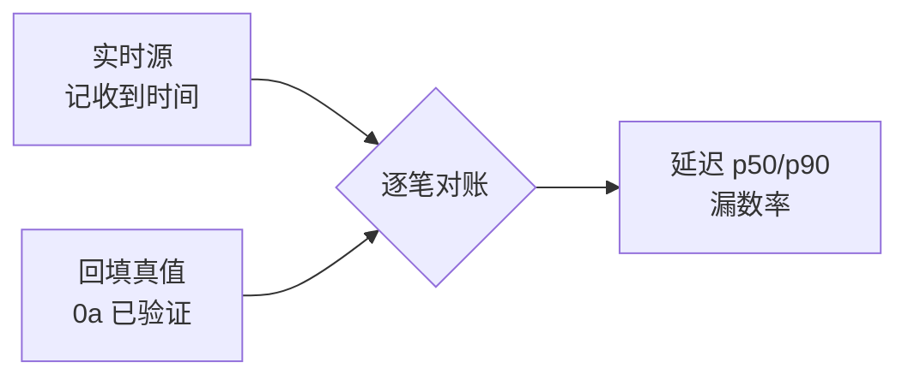

# meme 链上异动监测 · 阶段 0 任务书（MVP 草稿）

2026-11-20 · **阶段 0 完成：0a（能不能拿）、0b（即时性）、0c（按代币订阅）都已实测，待 July 决定下一步**

> meme 支线，和 LP 3.0 是两条线：只看代币本身，不看 LP 收益；两条线的证据不互相替代。
> 只做研究和观察：不交易、不连钱包、不签名、不动资金。

## 0c 结果（11-20，按代币订阅联合曲线，1 小时低谷）

**按代币订阅能用，但不比订 pump 全量轻：免费节点最多同时订 400 条曲线，消息量和全量差不多。**

- 公共节点硬上限（实测，无公开文档，待确认）：**每个连接 100 个订阅**，超了整条连接被断；**每个 IP 5 个连接**，第 6 个返回 429。退订能腾名额。1 个连接收建币，剩 **400 条曲线**。
- 每个新币订 15 分钟：覆盖 **95.3%**（40 条曲线 8,330 笔对账），延迟 **p50 2.2 秒、p90 5.6 秒**；1 小时服务器断开 19 次，每次空窗约 3.5 秒；满 400 时跳过 4.5% 的新币。
- **新币前 1 分钟占 67% 的消息，前 2 分钟占 77%**，15 分钟后几乎没有；约 217 条/秒，76% 是失败交易。
- 订阅生效前（上链后 p50 2.5 秒），每个币已有成功成交 p50 1 笔、p90 21 笔，这段只能回填。
- 低谷时不比订全量好（全量 98–100%、p90 3–9 秒）。**高峰时是否更好：unknown，要高峰实测。**

## 0b 结果（11-19，3 个 2 小时窗口，含美国白天高峰）

**免费公共节点在低谷和高峰都够用于：建币、毕业、指定池子的成交。不够用于：高峰时订阅 pump 程序全量成交。**

| 数据 | 推荐来源 | 低谷（w1 / w2） | 高峰（w3） |
| --- | --- | --- | --- |
| 建币 | 公共节点订阅 + 每 2 秒轮询 | 100% 不漏；p90 ≤ 3.8 秒 | 100% 不漏；p90 4.4 秒 |
| 毕业前成交 | 公共节点订阅 pump 程序全量 | 98–100%；p90 3–9 秒 | 97–100%；**p50 7 秒、p90 23–37 秒；2 小时断线 25 次** |
| 毕业 | 公共节点订阅 pump 程序 | 104/104；p90 4–12 秒 | 70/74；p90 28 秒 |
| 毕业后池子成交 | 公共节点订阅指定池子 | 96–100%；p90 ≤ 7.8 秒 | 99–100%；p90 ≤ 7.3 秒 |

延迟 = 收到时间 − 链上出块时间；真值用 0a 的回填方法逐笔对账。

**对照的第三方**
- **PumpPortal**：快（p50 约 1 秒），但建币只收到 15–31%，毕业漏 0–35%。不能当主源。
- **DexScreener**：新池约 40–70 秒后才能查到，只能事后核对。

**建议**
- 毕业前成交不订全量，改成按代币订阅联合曲线账户（和池子一样，量小、延迟低）。
- 先测公共节点最多能同时订多少个（目前 unknown，本次最多 6 个）；不够再考虑付费 gRPC（需 July 批准）。
- 阶段 1 的特征按可得的即时性设计：建币、毕业、毕业后成交可以到「秒到十秒级」；毕业前全量成交在高峰只能按「分钟级」设计。

> 以下「结论」到「0b 的产出」是 0b 开工前的计划，保留不改，便于对照。

## 结论

**阶段 0 拆成两步。0a「能不能拿」已做完；新增 0b「多快能拿到」，专门测即时性。**

- meme 几小时就走完好几轮，数据晚几小时就没用。所以每个数据源除了「能拿什么、能拿多频」，还要实测**从上链到我们收到隔了多久**、**有没有漏**。
- 方向按 July 的判断：**全节点数据（链上实时推送）优先，打狗工具其次**。
- 研究和实盘要用同一种数据：阶段 1 找共性用的特征，必须是实时源当时就能算出来的，否则回测好看、实盘用不上。所以先选定实时源，再定研究口径。
- 0a 测出的「慢」是**回填历史**慢（3.5 秒一次调用）；实时是另一种取法（订阅推送），这个慢不直接适用，要在 0b 里实测。
- 0b 只用免费、不注册的来源：预计 1 个工作日，$0，不建定时任务。

## 各数据源的即时性（桌面调研，11-19）

| 来源 | 类型 | 即时性 | 能不能用 | 备注 |
| --- | --- | --- | --- | --- |
| Solana 公共节点 · 订阅推送（websocket `logsSubscribe`） | 官方链上，全节点数据 | 理论上秒级，**待 0b 实测** | 能，免费不注册 | 订阅只能按一个地址过滤；高峰时会不会丢消息未知 |
| Solana 公共节点 · 轮询（每几秒查一次签名） | 官方链上 | 取决于轮询间隔，**待 0b 实测** | 能，免费不注册 | 0a 已验证数据完整 |
| 付费 RPC 的 gRPC 流（Helius、Triton、Chainstack 等） | 官方链上数据，第三方托管 | 厂商自称毫秒级（未核实） | **需注册 + 付费** | 主网 gRPC 一般不在免费档：Chainstack 加购约 $49/月起，Helius LaserStream 约 $499/月起（厂商页面，待确认） |
| 自建全节点 | 官方链上 | 最快 | 不建议 | 硬件和运维成本高，金额待确认；只在付费 RPC 也不够时再考虑 |
| GMGN OpenAPI | **打狗工具，第三方** | 自称「每次查询都是实时」，无 SLA | **需申请 API key（注册）** | 有新币列表、持有者、K 线；也有聪明钱 / KOL / 钱包追踪接口，**边界风险，需 July 定** |
| Axiom、Photon、BullX、Padre 等 | 打狗工具 | — | **不用** | 没有官方公开 API，只能抓前端，违反取数规则 |
| PumpPortal 推送 | 第三方，**单独标注** | 未公布 | 新币 / 毕业流免费；**逐笔成交流要绑定钱包并充值，不用** | 只用来对照新币和毕业的延迟 |
| DexScreener 公开 API | 第三方聚合，**单独标注** | 未公布，待 0b 实测 | 能，免费不注册 | 只看毕业后池子多久能查到 |
| Dune | 第三方（解码后的链上表） | **慢**：Dune 自己的监控显示 `dex_solana.trades` 延迟 p50 5.2 小时、p90 11.7 小时 | 只能补历史，**不能做实时** | 和 July 判断一致 |

## 0b 测什么

同一个 2 小时窗口里，各实时源同时收数，记录收到时间；窗口结束后用 0a 验证过的回填方法拿真值，逐笔对账。高峰和低谷各测一次。

| # | 测什么 | 来源 | 判「够用」的标准（建议，待 July 定） |
| --- | --- | --- | --- |
| R1 | 新币建币 | 公共节点订阅（铸币权限账户）、公共节点轮询、PumpPortal 新币流 | 延迟 p90 ≤ 10 秒；漏数 ≤ 1% |
| R2 | 毕业前逐笔成交 | 公共节点订阅（pump 程序） | 延迟 p90 ≤ 10 秒；高峰漏数 ≤ 1% |
| R3 | 毕业和新池子 | 公共节点订阅、PumpPortal 毕业流、DexScreener | 延迟 p90 ≤ 30 秒 |
| R4 | 毕业后池子成交 | 公共节点订阅（只订 R3 发现的池子） | 能同时订几个池子不掉线；延迟 p90 ≤ 10 秒 |

记录方式：每条消息记「链上出块时间」和「收到时间」两个时间戳；断线、重连、丢消息都如实写「失败 / 暂缺 / unknown」。

不需要装新软件：用 Python 自带库写一个最小的 websocket 客户端。脚本和记录只放研究机 `~/lp-lab/meme-lab/token-watch/`。

## 0b 的产出

1. 即时性表：每个来源 × R1–R4 的延迟 p50 / p90、漏数率、断线次数。
2. 推荐的实时源组合，以及它对应的历史回填口径（两边要一致）。
3. 如果免费源不够：列出付费 gRPC 或 GMGN 的具体价格和要注册的东西，交 July 决定。

## 0a 结果（11-18，已完成）：数据能不能拿

**数据能拿；回填历史慢**（公共节点约 3.5 秒一次调用：~200 个币约 1.6 天，~2000 个约 16 天）。

| # | 数据 | 判定 | 关键证据 |
| --- | --- | --- | --- |
| D1 | 建币全集 | **能拿** | 1 天 48,226 笔，221 秒翻完；抽 300 解码 300/300；随机 150 个区块独立核对 13/13 |
| D2 | 毕业前逐笔成交 | **能拿** | 23 个币全部翻到建币那一笔；取交易失败 1/1,559；字段 0 缺失 |
| D3 | 毕业事件 + canonical 池 | **能拿** | 12/12 找到迁移事件，12/12 是 canonical 池 |
| D4 | 毕业后池子成交和价格 | **部分能拿** | 小池可行（482–798 笔/小时）；热门池约 10.6 万笔/小时，40 笔里只有 1 笔是本池成交，翻不完 |
| D5 | 某时点持有者分布 | **部分能拿** | 当前大户查询 23/23 被限流（失败）；从成交推算小币可行 |
| D6 | 历史回溯深度 | **能拿，≥ 30 天** | 7/10/30 天前各 3 个币，9/9 翻到；30 天以上 unknown |
| D7 | 平台份额（协议级） | **能拿协议级** | DefiLlama Launchpad 30 天：pump.fun 76.4%，其余单个 ≤ 5.2%；新币成交份额暂缺 |

**0a 的发现**

- 约 14% 的新币不用 SOL 计价（代币化股票、USDC、PUMP 等作 quote）。算不算 meme，待 July 定。
- 毕业率约 4%（11-17 抽 300 个，12 个已毕业）。
- pump 程序上 87% 的交易失败，热门池签名大多是机器人；翻签名的量远大于真实成交。

## 不做的事

- 不定义爆发、不算特征、不打标签、不回测。
- 不交易、不连钱包、不签名、不动资金；需要绑定钱包的接口一律不用。
- 不改、不导入 LP 研究的任何脚本和代码；不写 LP 的输出目录；不动 LP 的定时任务。
- 不建定时任务、不注册账号、不付费、不调前端接口。
- 默认不调 GeckoTerminal；要调就避开 LP 3.0 的运行时段，间隔 ≥ 7 秒。

## 之后的阶段（只列，阶段 0 结论出来再写）

| 阶段 | 要回答的问题 |
| --- | --- |
| 1 采样 | 「爆发」怎么定义才可测；**第一步测覆盖率**（见下）；用和实时源一致的口径抽样落盘 |
| 2 找共性 | 后来爆发的币在早期有哪些共性；按时间切分回测 |
| 3 影子运行 | 候选规则只记录、不推送，72 小时后对账 |

**阶段 1 第一步：覆盖率**（照 LP 的双口径，11-20 定）
- 分母：同期全市场的「爆发币」，口径跟阶段 1 的爆发定义走，所以不在阶段 0 单独测。
- 先把爆发定义用到 Solana 全市场，找出爆发币，逐个查：是不是 pump.fun 创建、是不是 SOL 计价、毕业后的成交有多少在 PumpSwap 官方池。
- 覆盖率算两个：按币数，按成交额。链这一层用 DefiLlama 各链 DEX 成交额做粗分母，标「代理口径」。
- 只用离线历史数据（Dune、DexScreener 可以，晚几小时不影响），$0，不注册。
- 用途：标明结论的适用范围（例如「适用于 pump.fun 出身、SOL 计价的币」）。如果以后要扩到其他链，或者转做实时监控，就提前单独测。

阶段 1 开始前还要先定边界：只用代币层面的汇总特征（成交、独立买家数、集中度等），不给钱包打跨币标签、不维护地址名单。这样不会滑向跟单或聪明钱。

## 需要 July 决定的事

| # | 问题 | 建议 |
| --- | --- | --- |
| 1 | 是否按调整版开工 0b | ~~开工~~ **已完成（11-19）** |
| 2 | 延迟标准：成交 p90 ≤ 10 秒、毕业 p90 ≤ 30 秒 | 低谷达标；**高峰时 pump 程序全量不达标**（p90 23–37 秒） |
| 3 | 测「按代币订阅联合曲线」的并发上限 | **已完成（11-20）**：400 条；低谷不比全量好 |
| 3b | 高峰时段（UTC 14–16）再跑 1 小时按币订阅，和全量对比 | **建议做**（1 小时 + 对账，$0）；结果决定要不要付费 gRPC |
| 4 | GMGN OpenAPI：要注册，且带聪明钱 / KOL 接口 | 先不用 |
| 5 | 付费 gRPC（约 $49–$499/月，待确认） | 等第 3b 项结果再问 |
| 6 | 非 SOL 计价的新币（约 14%）算不算 meme | 待 July 定 |

## 相关文件

- 0c 完整报告：研究机 `~/lp-lab/meme-lab/token-watch/out/stage0c-curve-subs-2026-11-20.md`
- 0b 完整报告：研究机 `~/lp-lab/meme-lab/token-watch/out/stage0b-freshness-2026-11-19.md`
- 0a 完整报告：研究机 `~/lp-lab/meme-lab/token-watch/out/stage0-data-availability-2026-11-18.md`
- LP 角度的阶段 0 证伪报告（结论：Pump 对 LP 无意义）：研究机 `~/lp-lab/meme-lab/stage0-report-2026-11-18.md`
- 启动前的原始任务书见本文件的 git 历史（提交 41844e7）。
