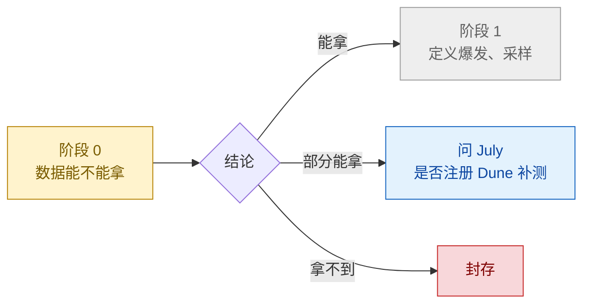
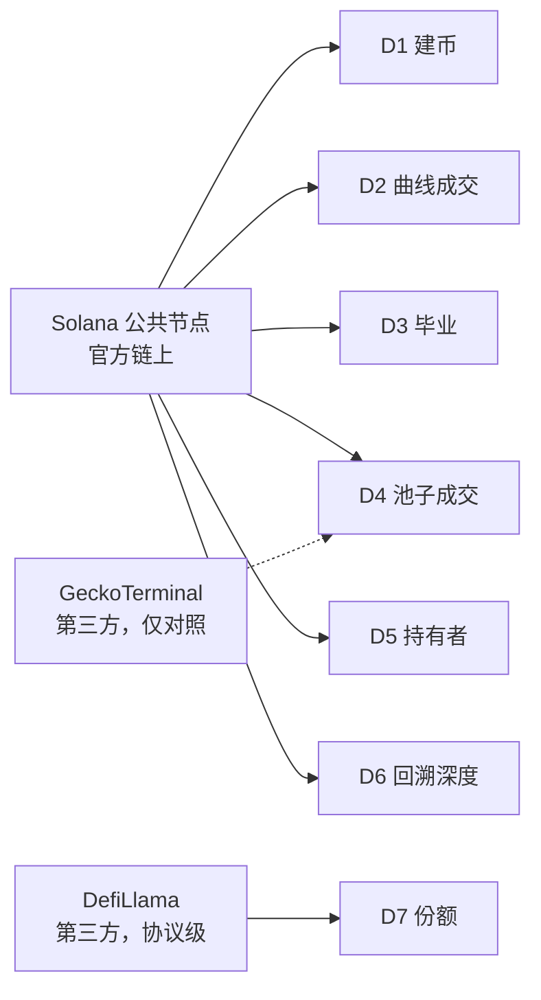

# meme 链上异动监测 · 阶段 0 任务书（MVP 草稿）

2026-11-18 · **草稿，未开工，待 July 决定是否启动**

> meme 支线，和 LP 3.0 是两条线：只看代币本身，不看 LP 收益；两条线的证据不互相替代。
> 只做研究和观察：不交易、不连钱包、不签名、不动资金。

## 结论

**阶段 0 只回答一个问题：研究要用的数据，能不能拿、怎么拿、拿到什么程度。**

不定义「爆发」，不验证假设，不回测。这些都要等数据结论出来再定。

- **范围**：只看 Solana 的 pump.fun（毕业前的联合曲线）和 PumpSwap 官方池（毕业后）。
- **方法**：用免费、不注册的来源做小样本实测：1 天的建币事件、20 个代币。
- **代价**：预计 2–3 个工作日，$0，不建定时任务。
- **产出**：一张数据可得性表，7 项数据逐项写「能拿 / 部分能拿 / 拿不到 / unknown」，附证据和成本估算。

黄 = 待启动；灰 = 未开始；蓝 = 需要 July 决定；红 = 止损。

## 要核实的 7 项数据

| # | 数据 | 研究里拿来做什么 | 预期 |
| --- | --- | --- | --- |
| D1 | 建币事件全集：上线时间、mint、创建者 | 样本从全集里抽，避免幸存者偏差 | 能拿，待确认 |
| D2 | 毕业前逐笔成交：买 / 卖、金额、钱包 | 独立买家数、买卖比、成交加速度、开发者卖出 | 能拿，待确认 |
| D3 | 毕业事件和对应的 canonical 池 | 区分毕业 / 未毕业；找到毕业后的官方池 | 能拿 |
| D4 | 毕业后 canonical 池的成交和价格 | 看代币后来涨没涨（以后打标签用） | 部分能拿：热门池成交太多，可能翻不完 |
| D5 | 某个时点的持有者分布 | 持仓集中度 | 部分能拿：只能从成交推算，看不到钱包间转账 |
| D6 | 历史能回溯多深 | 决定能不能用过去的数据做研究 | unknown |
| D7 | 各平台份额（协议级） | 确认 pump.fun 是不是主战场 | 能拿协议级；「新币成交份额」拿不到 |

**已知拿不到的**（免费、不注册的前提下，不再花时间测）：全量代币的全天成交（PumpSwap 约 200 笔/秒，公共节点每批只覆盖几秒）、30 天以上的全量历史、社交热度。

## 怎么拿

| 来源 | 性质 | 用来拿什么 | key / 账号 | 11-18 实测 |
| --- | --- | --- | --- | --- |
| Solana 公共节点 `api.mainnet-beta.solana.com` | 官方链上 | D1–D6 | 不需要 | 1164 次调用 0 失败；成交事件字段齐全；`getTokenLargestAccounts` 1/1 被限流 |
| DefiLlama | 第三方，只到协议级 | D7 | 不需要 | 能拉到 PumpSwap 协议级数据 |
| GeckoTerminal | 第三方聚合，**单独标注** | D4 的对照，只在公共节点翻不完时用 | 不需要 | 6.5 秒间隔仍有 30% 被限流；**和 LP 3.0 共用 IP 限额** |
| Dune | 第三方（解码后的链上表） | 本阶段不用；公共节点不够时的备选 | **需要注册** | 未测 |
| pump.fun 前端接口 | **前端耦合** | 不用 | — | 不调用 |

## 核实方法和判定标准

每项都用小样本实测，记录覆盖率、失败率、调用次数和耗时。

| # | 怎么测 | 判「能拿」的标准 |
| --- | --- | --- |
| D1 | 按 pump.fun 铸币权限账户翻 1 天的签名，用官方 IDL 解出建币事件；另取 10 分钟窗口，把程序全部签名里的建币逐笔对上 | 10 分钟窗口 100% 对上；1 天跑完失败率 < 5% |
| D2 | 取 20 个代币（含毕业和未毕业），按联合曲线账户翻全部签名、解成交 | 20 个都翻到建币那一笔；失败率 < 5%；给出单币平均调用次数 |
| D3 | 对 D2 里毕业的币，找毕业事件和迁移出的 canonical 池 | 100% 找到（11-18 已用同样方法核过 22 个池） |
| D4 | 挑 1 个成交多的 canonical 池，翻 72 小时内全部成交 | 按调用次数外推：100 个毕业币 ≤ 24 小时能翻完；否则判「部分能拿」，用 GeckoTerminal K 线作替代并标第三方 |
| D5 | 用 D2 的成交推算 t 时点持仓；20 个币各查一次当前大户，间隔 ≥ 7 秒 | 推算可行即判「部分能拿」（转账看不到这一点不会变）；当前大户查询的失败率如实记录 |
| D6 | 对 7、10、30 天前上线的币各取 3 个，看能不能翻到建币那一笔 | 记录最远能翻到第几天；≥ 10 天才够阶段 1 用 |
| D7 | 拉 PumpSwap、pump.fun、Raydium LaunchLab、Meteora DBC、Four.meme 的协议级成交 | 能拉到即可；拉不到的平台写「失败」或「暂缺」 |

所有失败、缺数、未知分别写「失败 / 暂缺 / unknown」，不用估算值顶替。

## 交付物

1. **数据可得性表**：D1–D7 每项的判定、证据（调用次数、失败率、样本）和原始记录位置。
2. **成本估算**：如果阶段 1 抽 3 天建币、约 2000 个代币，公共节点要跑多久。
3. **一句话建议**：进入阶段 1、先注册 Dune 补测，还是封存。

脚本和原始记录放在研究机 `~/lp-lab/meme-lab/token-watch/`，和 LP 研究目录分开。线上只同步本任务书。

## 不做的事

- 不定义爆发、不算特征、不打标签、不回测。
- 不交易、不连钱包、不签名、不动资金。
- 不改、不导入 LP 研究的任何脚本和代码；不写 LP 的输出目录；不动 LP 的定时任务。
- 不建定时任务、不注册账号、不付费、不调前端接口。
- 默认不调 GeckoTerminal；要调就避开 LP 3.0 的运行时段，间隔 ≥ 7 秒。

## 之后的阶段（只列，阶段 0 结论出来再写）

| 阶段 | 要回答的问题 |
| --- | --- |
| 1 采样 | 「爆发」怎么定义才可测；按阶段 0 的结论抽样落盘 |
| 2 找共性 | 后来爆发的币在早期有哪些共性；按时间切分回测 |
| 3 影子运行 | 候选规则只记录、不推送，72 小时后对账 |

阶段 1 开始前还要先定边界：只用代币层面的汇总特征（成交、独立买家数、集中度等），不给钱包打跨币标签、不维护地址名单。这样不会滑向跟单或聪明钱。

## 风险

| 风险 | 应对 |
| --- | --- |
| 公共节点翻不了几天前的数据（D6） | 如实记录；这是决定要不要注册 Dune 的关键证据 |
| 热门池成交太多，翻不完（D4） | 用 GeckoTerminal K 线替代并标第三方；或在阶段 1 前问 July 是否注册 Dune |
| 调 GeckoTerminal 挤占 LP 3.0 的限额 | 默认不调；要调就避开 3.0 时段 |
| 平台格局信息截至 2026 年 6 月，可能已变 | 份额以 D7 实测为准 |

## 需要 July 决定的事

| # | 问题 | 建议 |
| --- | --- | --- |
| 1 | 是否启动阶段 0 | **启动**：2–3 个工作日，$0，不注册，不建定时任务 |
| 2 | 范围是否只看 pump.fun | 是；其他平台只在 D7 里看份额 |
| 3 | 如果结论是「部分能拿」，是否注册 Dune 免费账号补测 | 阶段 0 结束后再问 |

## 相关文件

- LP 角度的阶段 0 证伪报告（结论：Pump 对 LP 无意义）：研究机 `~/lp-lab/meme-lab/stage0-report-2026-11-18.md`
