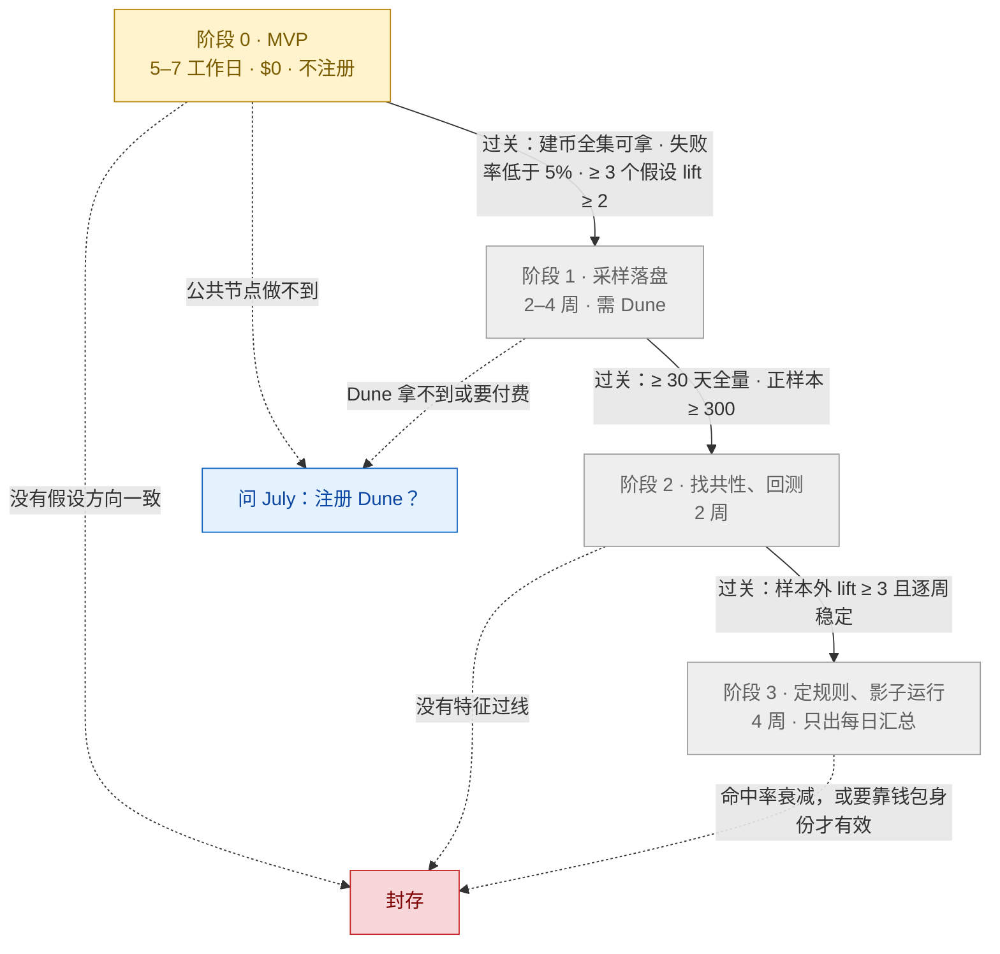
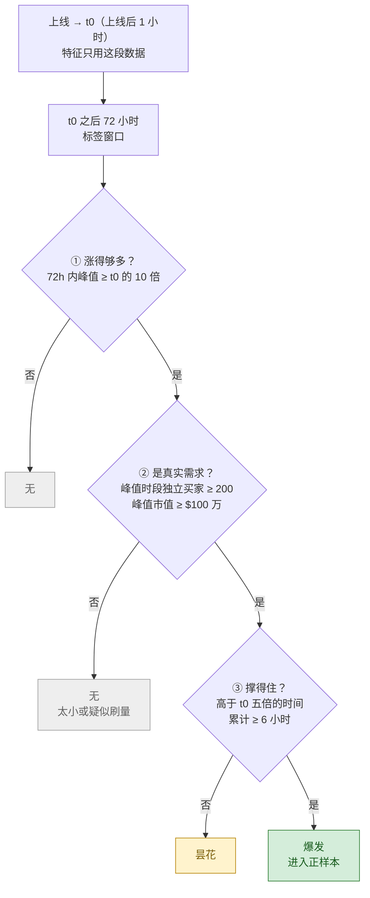
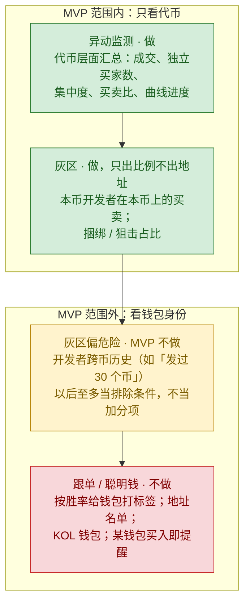
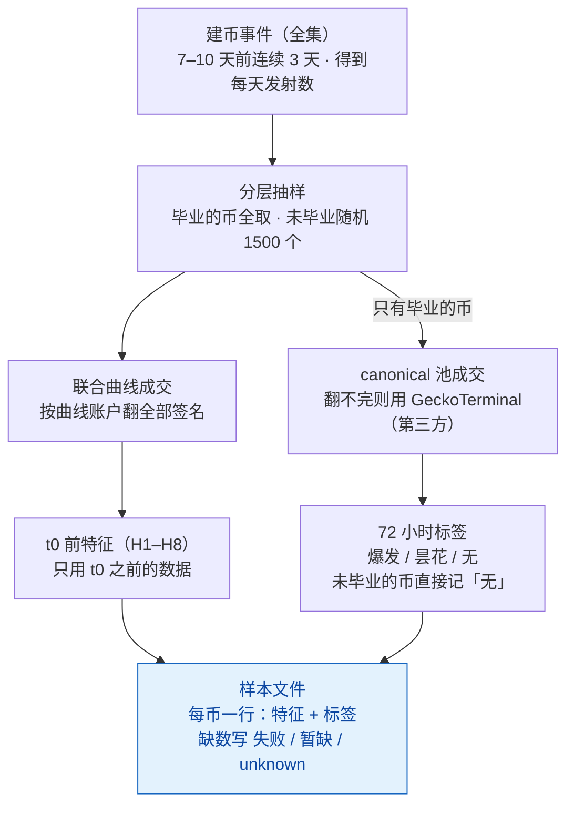

# meme 链上异动监测 · 阶段 0 任务书（MVP 草稿）

2026-11-18 · **草稿，未开工，待 July 决定是否启动**

> meme 支线，和 LP 3.0 是两条线：只看代币本身，不看 LP 收益；两条线的证据不互相替代，结论不互相推荐。
> 只做研究和观察：不交易、不连钱包、不签名、不动资金；产出是有数据支撑的共性和假设，不是买卖建议。

## 现状和结论

**结论：MVP 能在 0 成本、不注册、不建定时任务的前提下，回答「这条线值不值得做下去」，但回答不了「规则是什么」。**

MVP 只做 Solana 的 pump.fun 到 PumpSwap 一条链路：用公共节点回溯抽样 7–10 天前上线的代币。这批币上线已超过 72 小时，结局已经能看到，所以不需要前向采集。

- **能做到**：上线时间、毕业前逐笔成交、独立买家数、买卖比、开发者在本币上的卖出、毕业与否；份额只能做协议级对照。
- **部分做到**：持有者分布（只能从联合曲线上的买卖推算，看不到钱包间转账）；爆发基准率（样本小，只能给区间）。
- **做不到**：全量代币的全天成交、30 天以上全量历史、历史持有者快照、社交热度、正样本 ≥ 300 的正式回测。这些要 Dune 或付费索引服务，需要 July 先同意注册。

**现状**：11-18 已完成 LP 角度的阶段 0 证伪（结论：Pump 对 LP 无意义，建议封存）。本任务书是另一条线。开发没有开始，没有建定时任务，没有改动任何 LP 文件。

**和 LP 研究隔离**：meme 线不改、不导入 LP 的任何脚本和代码，不写 LP 的输出目录，不改 LP 的定时任务。调 GeckoTerminal 时避开 3.0 任务时段，免得同一 IP 的限流波及 LP。

### 状态一览

黄 = 待 July 启动；灰 = 未开始；蓝 = 需要 July 决定；红 = 止损。实线 = 过关；虚线 = 不过关。只有阶段 0 在本任务书范围内。

## 范围一览

MVP 只采 pump.fun 联合曲线和毕业后的 PumpSwap 官方池（canonical 池）。其他平台只拿协议级数据算份额，不采代币。

| 链 | 平台 | MVP 里做什么 | 把握 |
| --- | --- | --- | --- |
| Solana | pump.fun 联合曲线 | **主样本**：建币、毕业前成交、毕业 | 确定 |
| Solana | PumpSwap canonical 池 | **主样本**：毕业后价格，用来打爆发标签 | 确定 |
| Solana | PumpSwap 用户自建池 | **排除**：成交榜前 30 里 28 个是自建池，其中 27 个 SOL 储备已被抽到接近 0（LP 线阶段 0 证伪报告，11-18） | 确定 |
| Solana | Raydium LaunchLab、Meteora DBC | 只拿协议级数据算份额 | 存在确定；份额待确认 |
| BSC | Four.meme | 只拿协议级数据算份额 | 现状待确认 |
| Base | Clanker、Zora | 只登记 | 待确认 |
| Robinhood 链 | 有没有发射平台 unknown | 只核实，不进样本 | unknown |
| Tron、TON | SunPump、BigPump | 不做：DefiLlama TVL 接近 0（11-18） | 确定 |

**份额口径**：主口径 = 上线 7 天内新币的成交额；辅口径 = 每天发射数、毕业数。不用手续费（PumpSwap 手续费占全市场 DEX 30.9%、成交只占 2.9%，费率分档会扭曲份额），不用市值。

**MVP 能算到哪一步**：DefiLlama 只有协议级数据，算不出「新币成交」。MVP 只能给协议级成交份额作替代，并标注口径不同；新币成交份额 = 暂缺，要 Dune。

## 为什么这么定

- **只做一条链路**：pump.fun 是唯一已在链上实测过的平台，成交事件字段齐全，1164 次公共节点调用 0 失败（11-18 实测）。毕业后自动迁入 canonical 池，一个代币从出生到结局都在链上可追。
- **回溯抽样，不做前向采集**：只抽 7–10 天前上线的币，结局已定，一次性批量跑完就能打标签，不需要定时任务。
- **从建币事件抽样，不从榜单抽**：从成交榜、CoinGecko 或 GeckoTerminal 热门榜抽，只会拿到活下来的币，结论全部偏乐观。
- **先 MVP 再注册**：LP 线的证伪报告建议「不需要注册 Dune」，那是针对 LP 问题。代币线的正式回测大概率需要 Dune，但在小样本证明「特征算得出、有区分度」之前，不值得为它注册。
- **重开方向的前提**：July 之前对 meme 的定位是「收尾观察，不建立新的跟单或聪明钱监控」。MVP 只用代币层面的汇总特征，不碰钱包身份。

## 数据源

MVP 的主干是 Solana 公共节点（官方链上）。第三方聚合只作对照，前端接口不用。实测数字均来自 2026-11-18 研究机。

| 来源 | 性质 | MVP 用它做什么 | 历史 | key / 账号 | 已知情况 | MVP 状态 |
| --- | --- | --- | --- | --- | --- | --- |
| Solana 公共节点 | 官方链上 | 找建币交易；按抽样代币的曲线账户和 canonical 池翻签名，解出建币 / 成交 / 毕业事件 | 按单个账户能翻多深：待确认 | 不需要 | 1164 次调用 0 失败；`getTokenLargestAccounts` 1/1 被限流；PumpSwap 整体约 200 笔/秒，全量覆盖不了 | **主干，只做抽样** |
| DefiLlama | 第三方，协议级 | 协议级成交，算份额对照 | 有 | 不需要 | 不分新币 / 老币 | **可用** |
| GeckoTerminal | 第三方聚合，**单独标注** | 可选：canonical 池 K 线，作爆发标签对照 | K 线能回溯多久：待确认 | 不需要 | 6.5 秒间隔仍 30% 被限流；**和 LP 3.0 共用 IP 限额** | **只作对照**，避开 3.0 时段 |
| CoinGecko（免 key） | 第三方聚合，**单独标注** | 不用于取样；只看爆发币后来是否被收录 | — | 不需要 | 25 次 0 失败；被收录 = 已活下来，有幸存者偏差 | **仅参考** |
| Dune | 第三方（解码后的链上表） | MVP 不用；正式回测的历史主干 | 有 | **需要注册**；API 是否付费待确认 | 未测 | **MVP 外，需 July 同意** |
| Helius / Triton / Bitquery | 第三方 RPC / 索引 | MVP 不用 | 部分 | 需注册或付费 | 未测 | **MVP 外** |
| pump.fun 前端接口 | **前端耦合** | 不用 | — | — | 不调用 | **不用** |
| 社交（X 等） | 第三方 | 不用 | — | 付费 | — | **暂缺** |

**MVP 第一天先核实三件事**：

1. **怎么只拿建币交易**。假设 pump.fun 的铸币权限账户只出现在建币交易里，按它翻签名就是全部建币。待确认：用官方 IDL 对一小段时间逐笔核对。
2. **公共节点能翻多深**。按单个账户翻签名能不能翻到 10 天前。待确认：对 10 个老代币试翻。
3. **爆发币的池子翻不翻得完**。canonical 池成交可能上万笔。待确认：算一个池翻完要多少次调用；太慢就用 GeckoTerminal K 线打标签，并标注为第三方。

## 能力清单：MVP 能做到什么

16 项需求里：✅ 能做到 5 项，⚠️ 部分做到 4 项，❌ 做不到 6 项，❓ 待确认 1 项。做不到的大多卡在「全量」和「历史」上，要 Dune 或付费索引才能补。

| 需求 | MVP | 怎么做 / 为什么做不到 | 补齐需要 |
| --- | --- | --- | --- |
| 上线时间 | ✅ | 建币交易的区块时间 | — |
| 毕业前逐笔成交、买卖笔数、买卖比 | ✅ | 按联合曲线账户翻全部签名，解成交事件 | — |
| 独立买家数 | ✅ | 成交事件里的去重钱包，只输出数量 | — |
| 是否毕业、毕业用时 | ✅ | 毕业事件和迁移交易 | — |
| 开发者在本币上的买卖 | ✅ | 建币事件给出创建者，跟踪它在本币曲线上的成交 | — |
| 爆发标签（72 小时结局） | ❓ | 池子成交翻得完就用链上；翻不完用 GeckoTerminal K 线并标第三方 | 先实测公共节点翻页成本 |
| 持有者数量和集中度（t0 时） | ⚠️ | 只能从曲线上的买卖推算；钱包间直接转账看不到，会低估集中度 | Dune 转账表或付费索引 |
| 捆绑买入（建币同一 slot 内买入占比） | ⚠️ | 抽样代币能算；只输出比例，不输出地址 | — |
| 份额 | ⚠️ | 只有协议级成交；新币成交份额 = 暂缺 | Dune |
| 爆发基准率 | ⚠️ | 抽样数千个币能给区间；正样本 < 30 时只写「unknown，样本不足」 | Dune 全量 |
| 全量代币全天成交 | ❌ | 公共节点每批只覆盖几秒，PumpSwap 约 200 笔/秒 | Dune 或付费索引 |
| 30 天以上全量历史回测 | ❌ | 只能逐个代币抽样，量上不去 | Dune |
| 正样本 ≥ 300 的正式回测 | ❌ | 爆发率若在千分之一量级，要抽几十万个币 | Dune |
| 历史时点的完整持有者快照 | ❌ | 链上只有当前状态；当前大户查询也被限流 | Dune 转账表重建 |
| 社交热度 | ❌ | 没有免费稳定源 | X API 等，需付费 |
| 其他平台的代币级样本 | ❌ | MVP 不覆盖 LaunchLab、Meteora DBC、Four.meme | 各平台单独核实 |

## 爆发定义与待验证的假设

**爆发定义（默认值，MVP 第一周标定后冻结）**：

- **价格**：链上成交按 15 分钟分桶的成交量加权均价，不用单笔价格。
- **另算一套 t0**：以「毕业那一刻」为 t0 再算一遍。
- **MVP 只做标定，不做优化**：看默认参数下正样本有多少，太少就放宽到 5 倍，并记录改动原因。

**待验证的假设**（全是假设，不是规则）。统一验证方法：比较「爆发」组和「无」组的分布，看提升倍数（lift）。MVP 样本小，只判断「方向是否一致、值不值得进正式回测」，不判断显著性。

| # | 假设 | 怎么算（t0 前） | 预期方向 | MVP 能否验证 |
| --- | --- | --- | --- | --- |
| H1 | 曲线进度越快越可能爆发 | 到毕业进度 50% 用了多少分钟 | 正向 | ✅ |
| H2 | 独立买家越多越可能爆发 | 去重买家数 | 正向 | ✅ |
| H3 | 持仓越集中越不可能爆发 | 前 10 大持仓占比，扣掉曲线账户 | 负向 | ⚠️ 看不到转账 |
| H4 | 捆绑买入多的多半是收割 | 建币同一 slot 内买入占比 | 负向 | ✅ |
| H5 | 开发者提前卖出的不会爆发 | t0 前创建者卖出占其持仓比例 | 负向 | ✅ |
| H6 | 成交在加速的更可能爆发 | 最近 15 分钟成交 ÷ 前 15 分钟 | 正向 | ✅ |
| H7 | 买卖比偏买的更可能爆发 | 按笔数、按金额各一个 | 待测 | ✅ |
| H8 | 上线时段有影响 | 新加坡时间、美东时间各记一个 | 控制变量 | ✅ |
| H9 | 社交热度领先价格 | — | — | ❌ 暂缺 |

## 不做的事

**硬边界**：

- 不交易、不连钱包、不签名、不动资金；产出是有数据支撑的共性和假设，不是买卖建议。
- 不改、不导入 LP 研究的任何脚本和代码；不写 LP 的输出目录；不改 LP 的定时任务。需要的通用代码（请求重试、录制回放）复制到 meme 线自己的目录。
- LP 3.0 的 meme 池存档不进样本（混有假 TVL 池），最多作对照。
- MVP 不建定时任务、不注册账号、不付费、不调前端接口。
- 失败、缺数、未知分别写「失败 / 暂缺 / unknown」，不用估算值顶替。

**异动监测 vs 跟单 / 聪明钱（分级由 July 定，下图是建议）**：

从上到下，越来越依赖钱包身份。输出形式也算边界：MVP 不做分钟级实时推送，以后影子运行也只出每日汇总。

如果 MVP 发现爆发主要靠「哪些钱包在买」才能提前看到，这条线在这个边界内做不成，应当封存，而不是越界。

## 阶段与判据

MVP 就是阶段 0，预计 5–7 个工作日，成本 $0，外部依赖是 Solana 公共节点和 DefiLlama。失败成本低：最坏情况是白花一周，得到一份「公共节点做不到」的证据。

**MVP 怎么抽样**：

除标注外，数据都来自 Solana 公共节点（官方链上读取）。统计时按抽样比例加权还原。调用量和耗时 unknown，第一天用 20 个币试跑后给出估算。

**MVP 交付物**（代码和产出放在研究机 `~/lp-lab/meme-lab/token-watch/`，和 LP 研究目录分开）：

- 数据源核实表：三件待确认的事，每件的结果和原始记录。
- 份额对照表：协议级成交，标注口径。
- 样本文件：每币一行，特征 + 标签；缺的字段写「失败 / 暂缺 / unknown」。
- 一页结论：爆发基准率区间、H1–H8 各自方向是否一致、是否建议注册 Dune 进入阶段 1。

**各阶段判据**：

| 阶段 | 时间 | 过关判据 | 止损封存 |
| --- | --- | --- | --- |
| 0 MVP（本任务书） | 5–7 工作日 | ① 公共节点能拿到全部建币事件；② 样本币特征失败率 < 5%；③ 至少 3 个假设在爆发组 / 无组间方向一致且 lift ≥ 2 | ① 做不到 → 问 July 是否注册 Dune；③ 一个都没有 → 封存 |
| 1 采样落盘 | 2–4 周 | Dune 补 ≥ 30 天全量；正样本 ≥ 300 | Dune 拿不到或要付费 → 问 July |
| 2 找共性、回测 | 2 周 | 假设先登记再检验；按时间切分，样本外 lift ≥ 3 且逐周稳定 | 没有特征过线 → 封存 |
| 3 定规则、影子运行 | 4 周 | 只记录、每日汇总；72 小时后对账，命中率不明显衰减 | 衰减，或要靠钱包身份才有效 → 封存 |

阶段 1 起需要定时任务，建之前单独问 July，并且不写进 LP 的任务模板。

## 风险

| 风险 | 影响 | 应对 |
| --- | --- | --- |
| 公共节点翻不到 10 天前，或爆发币池子成交太多翻不完 | 抽样做不了或标签不全 | 第一天先实测；标签退回 GeckoTerminal K 线并标第三方；仍不行就问 July 是否注册 Dune |
| 调 GeckoTerminal 抢了 LP 3.0 的限额 | LP 采集更多 429 | 默认不调；要调就避开 3.0 时段、间隔 ≥ 7 秒、记录每次调用 |
| 样本里爆发币太少 | 假设无法判断 | 如实写 unknown；这本身就是「需要全量数据」的证据 |
| 持仓推算看不到转账 | 集中度偏低，H3 结论可能错 | 标注为部分数据；正式版用 Dune 转账表 |
| 刷量、对倒把假爆发算进正样本 | 共性被污染 | 爆发定义要求独立买家 ≥ 200；只认 canonical 池 |
| 小样本里的「规律」是偶然 | 误导是否继续的决定 | MVP 只判断方向，不当结论；不调参 |
| 为了提高命中率滑向钱包身份 | 违反边界 | 边界先定；发现必须靠钱包身份就封存 |
| 平台改规则（毕业门槛、费率） | 历史样本不可比 | 记录样本期的链上配置（复用 LP 线证伪时读费率配置的方法） |
| 平台格局信息截至 2026 年 6 月 | 平台格局、份额可能已变 | 标「待确认」的一律以 MVP 实测为准 |

## 需要 July 决定的事

| # | 问题 | 建议 |
| --- | --- | --- |
| 1 | 是否重开 meme 方向，启动 MVP | **启动**：0 成本、不注册、不建定时任务，5–7 工作日给出是否值得继续 |
| 2 | 边界分级：开发者跨币历史、输出形式 | 跨币历史 MVP 不做；影子运行只出每日汇总 |
| 3 | 爆发定义的默认参数：10 倍 / 72 小时 / 累计 6 小时 / $100 万 / 200 买家 | 先用默认值标定，改动记录原因 |
| 4 | MVP 结果为正时，是否注册 Dune 免费账号 | MVP 结束后再问；现在不注册 |
| 5 | MVP 抽样规模：3 天建币 + 未毕业随机 1500 个 | 默认如此；想更快试水可缩到 1 天 + 500 个 |

## 相关文件

- LP 角度的阶段 0 证伪报告（结论：Pump 对 LP 无意义）：研究机 `~/lp-lab/meme-lab/stage0-report-2026-11-18.md`
- 早先的 meme 单开草稿（LP 角度，已过时）：研究机 `~/lp-lab/notes/TASK-meme-pump-draft.md`
