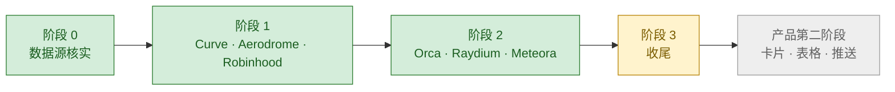
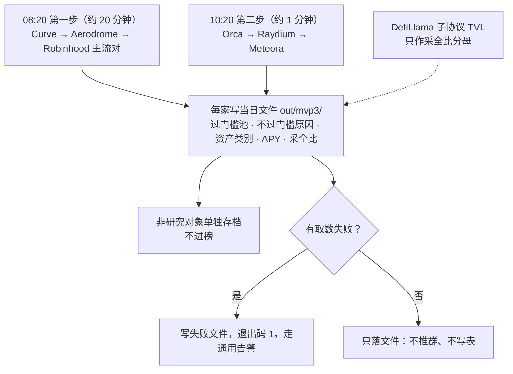
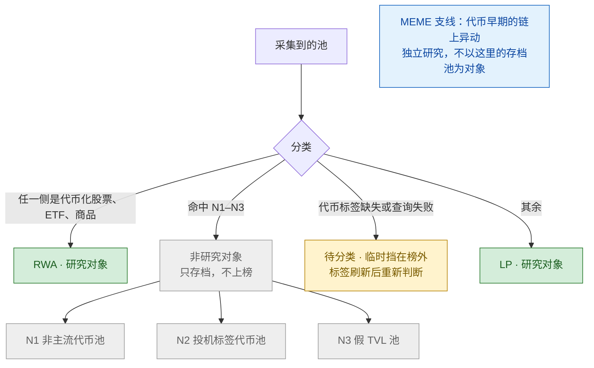
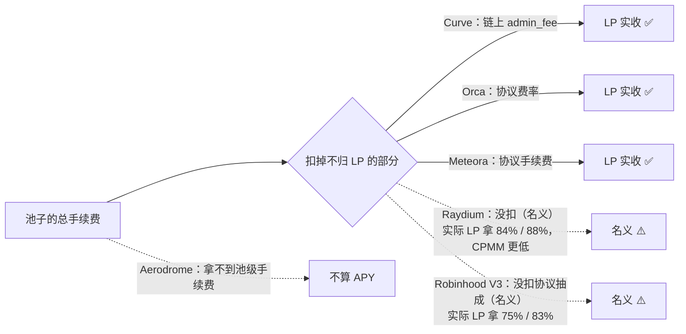

# LP 市场监控 3.0 任务书

2026-11-19 · Julywa

3.0 第一阶段只扩数据层：在 1.0（Uniswap 三链）和 2.0（Pancake · BSC、Uniswap RWA · Robinhood）之外，把 Curve、Aerodrome、Robinhood 主流交易对和 Solana 三家（Orca、Raydium、Meteora）接进来，只采集、只落本地文件，不发新卡片、不写多维表格。截至 11-18，两步采集每天自动运行，都已用上 11-16 的新采全比口径；扫描覆盖率按手续费算，第一步后 35.2%，第二步后 49.9%。阶段 2 于 11-17、阶段 1 于 11-18 有条件签收，条件（自然 3 日采全比）都已于 11-19 闭合。内部阶段 3 已于 11-18 开始：标签和股票名单刷新、扫描覆盖率每天重算在研究机干跑，字段清单定为第二阶段基线。核实发现 Raydium 和 Robinhood 主流对的 APY 是名义口径，没扣协议份额（见第 4 节），修正已写好，随模块化 1.1.0 发布。另外，6 块采集正在拆成独立模块，见[《3.0 模块化改造任务书》](lp-market-3.0-modular-brief.md)，交付前不影响现有任务。1.0、2.0 不动。

## 当前状态（11-19）

绿 = 完成（阶段 1、2 为有条件签收，条件已于 11-19 闭合）；黄 = 进行中；灰 = 未开始。

| 阶段 | 结果 | 还差什么 |
| --- | --- | --- |
| 0 数据源核实 | 11-12 完成，6 个源跨期比对通过 | — |
| 1 第一步采集 | **11-18 签收，条件 11-19 闭合**：连续 7 天运行成功；Curve 重抽 5/5；动态费率补丁实跑 8/8；自然 3 日采全比 Curve 109.7%、Aerodrome 100.1% | — |
| 2 第二步采集 | **11-17 签收，条件 11-19 闭合**：连续 6 天运行成功；官方接口抽查 15/15；分类抽查 19/20；自然 3 日采全比 Orca 81.8%、Meteora 95.5%（Raydium 豁免） | — |
| 3 收尾 | **进行中**：标签和名单刷新、覆盖率每天重算在研究机干跑；字段清单定为基线 | 干跑满 3 天（至 11-21）后签收 |
| 产品第二阶段 | 未开始 | 阶段 3 签收后写任务书 |

**需要知道的一件事**：Raydium 和 Robinhood 主流对的 APY 目前是名义口径，没扣协议份额，最多高估数倍（第 4 节）。修正已写好，随模块化 1.1.0 单独审批。

## 1. 范围一览

两步加 6 块市场。每块按 1.0 的口径采池级字段（池名、费率、TVL、24 小时成交、7 天成交、即时 APY、7 天 APY、部署天数），另加「资产类别」和「没过门槛的原因」两个字段，方便第二阶段跨协议合并。

| 步 | 协议 · 链 | 数据源 | 定时 | 11-17 TVL ≥ $50 万的池 | 过门槛 | 状态 |
| --- | --- | --- | --- | --- | --- | --- |
| 第一步 | Curve · Ethereum | Curve 官方 Prices API；TVL 用官方 getPools | 每天 08:20 | 133 | 128 | 11-18 有条件签收 |
| 第一步 | Aerodrome · Base | GeckoTerminal（7 个交易所编号合并） | 每天 08:20 | 91 | 90（股票和商品 8） | 11-18 有条件签收 |
| 第一步 | Robinhood 主流对（WETH/USDG 类） | GeckoTerminal | 每天 08:20 | 11 | 11（非研究对象另存 99） | 11-18 有条件签收 |
| 第二步 | Orca · Solana | Orca 官方 API | 每天 10:20（影子任务） | 53 | 49（股票和商品 2） | 11-17 有条件签收 |
| 第二步 | Raydium · Solana | Raydium 官方 API | 每天 10:20（影子任务） | 168 | 60（股票和商品 18） | 11-17 有条件签收 |
| 第二步 | Meteora DLMM + DAMM v2 · Solana | Meteora 官方 API | 每天 10:20（影子任务） | 48 | 35（股票和商品 5） | 11-17 有条件签收 |

数据：1 号机 11-17 08:20 和 10:20 自然运行产出。

股票池和代币池在采集时就分组，各排各的；非研究对象不上榜，单独存档（分类和原因见第 4 节「研究对象与非研究对象」）。第二步在验收前不并入 08:20 的生产默认范围。

**每天怎么跑**

1. 08:20 第一步启动：Curve、Aerodrome、Robinhood 依次取数，约 20 分钟。Aerodrome 和 Robinhood 共用 GeckoTerminal 限速，必须串行。
2. 每家过门槛、分资产类别、算 APY；非研究对象（非主流代币池、投机标签代币池、假 TVL 池）写进单独的存档文件。
3. 算采全比：读 DefiLlama 子协议 TVL 作分母，和前两天的单日值算 3 日均值。
4. 每家写一份当日文件到 `out/mvp3/`；任一家取数失败，写失败文件，任务以退出码 1 结束，走通用告警。
5. 10:20 第二步启动：Orca、Raydium、Meteora 同样流程，约 1 分钟，最后生成当日过滤分析。
6. 两步都不推群、不写表；低于 80% 的采全比只写文件和日志。

**Aerodrome 已改名 Aero。** 10-21 Aerodrome 和 Velodrome 合并成 Aero：新合约、新 AERO 代币、新前端 app.aero.xyz。合并前的旧池还在，旧前端 aerodrome.finance 仍能按地址查到。表里的「Aerodrome · Base」两种池都含：11-17 的 91 个大池里，Aero 新池 51 个，旧版池 40 个。

## 2. 为什么这么定

**覆盖率按手续费算，不按 TVL。** LP 赚的是手续费。很多 TVL 躺着不成交：Pancake 老版本 · BSC 占全市场 TVL 11.6%，手续费只有 1.1%；Meteora 正相反，TVL 1.3%，手续费 8.5%。TVL 和成交照样列出，只是不当主口径。

**覆盖 = 能拿到数据。** 协议和链在扫描范围里，它的池就算覆盖；被门槛和非研究对象规则筛掉的是「不要」，不是「看不到」。全市场 = DefiLlama 全部 DEX，近 30 天日均。

| 节点 | 扫描覆盖率（占全市场手续费） | 占成交 | 占 TVL | 不含 Pump 时 |
| --- | --- | --- | --- | --- |
| 1.0 + 2.0 现状 | 29.8% | 36.0% | 30.6% | 43.5% |
| 第一步后（+ Curve、Aerodrome、Robinhood 主流对） | 35.2% | 46.0% | 41.6% | 51.4% |
| 第二步后（+ Orca、Raydium、Meteora） | 49.9% | 52.7% | 52.7% | 72.8% |

数据：DefiLlama overview/fees、overview/dexs、/protocols，11-16 16:31 重新下载，用原脚本 `coverage_scope.py` 复算。任务书 11-11 的估算是约 36% 和约 49%，复算一致。全市场每天手续费约 $792 万。

| 范围 | 加入时间 | 占全市场手续费 |
| --- | --- | --- |
| Uniswap · Ethereum / Base / Arbitrum | 现有 1.0 | 17.2% |
| Uniswap · Robinhood | 现有 2.0 | 9.8% |
| Pancake V3 + Infinity · BSC | 现有 2.0 | 2.8% |
| Aerodrome · Base | 第一步 | 3.6% |
| Curve · Ethereum | 第一步 | 1.9% |
| Orca · Solana | 第二步 | 2.5% |
| Raydium · Solana | 第二步 | 3.7% |
| Meteora DLMM + DAMM v2 · Solana | 第二步 | 8.5% |

范围外最大的一块是 Pump · Solana（代币发射池，非研究对象，已定不做），一家占 31.4%。去掉它，剩下的是一条很长的尾巴，每再加一个协议只能带来 1–2 个点。

**Meteora 放最后，Raydium 要过滤假 TVL。** Meteora 手续费八九成在投机标签代币的小池里，价值是看到少数研究对象的大池；Raydium TVL 最大的几个池几乎不产生手续费，大多是 CoinGecko 未收录的代币。

## 3. 数据源

每块市场的排序数值只来自一个数据源。DefiLlama 只作覆盖率和采全比的分母，不参与排序：它对 Aerodrome 只采到两成，对 Meteora 一个池都没有。

| 协议 | 排序数值来源 | 准确性实测 | 注意 |
| --- | --- | --- | --- |
| Curve · Ethereum | Prices API（成交、手续费、7 天）；TVL 用官方 getPools（与 curve.fi 前端同源，不是网页抓取；11-16 补丁，11-17 生效） | Prices API 的 TVL 系统性偏高：134 个大池合计比前端高 5.8%，15 个池超过 5%，Yield Basis WBTC 高 43% | 数据超过 6 小时报错；前端接口失败时退回 Prices API 并写告警 |
| Aerodrome · Base（Aero + 旧版） | GeckoTerminal | 成交和链上逐笔对得上（偏差 0–4%）；11-16 前端抽查 3/5 在 5% 内 | 动态费率，池名费率不可靠；没有池级手续费，只上 TVL 榜和成交榜。高周转的 CL 池 GeckoTerminal 可能低估约 10%（WETH/USDC） |
| Robinhood 主流对 | GeckoTerminal | 和官方前端 TVL 5/5 一致（含 app.aero.xyz 上的 Aero 池） | 非 Uniswap 池的池名费率不能用：Ramses 实际 0.025%、池名 0.01%；Aero 池实际约 0.02%、池名 0.115%（11-16 核查） |
| Orca · Solana | Orca 官方接口 | 抽 5 池和前端单池接口全部在 5% 内 | 用游标翻页，大页会被静默截断 |
| Raydium · Solana | Raydium 官方接口 | 同上，5/5 | 要过滤假 TVL |
| Meteora · Solana | Meteora 官方接口（DLMM + DAMM v2） | 同上，5/5，最大偏差 −3.6% | 没有 7 天字段；DAMM v1 没有接口；拉完校验确实按 TVL 降序 |

**GeckoTerminal 波动大（11-17 实测）。** 同一批 Aero 池，08:20 与 12:38 两次采集的 TVL 相差很大：AERO/cbBTC +120%、cbBTC/USDC +70%、AERO/USDC −27%；同期 Solana 三家官方接口的中位偏差只有 0.2%–1%。当天 Aero 被限流 9 次、Robinhood 2 次，重试后都成功。Aero 官方 LpSugar 合约可作替代，阶段 3 之后另开任务书评估。

辅助数据源：CoinGecko（代币分类，含投机标签，即 CoinGecko 的 meme 类别；带 key）、coins.llama.fi（Raydium 和 Aerodrome 复查池的能定价一侧，公开）、publicnode（Curve admin_fee 链上只读）。coins.llama.fi 和 api.curve.finance 还没登记进数据源总表，见第 8 节。

## 4. 计算规则

门槛沿用 1.0 的「只排除明显噪声」思路。

| 规则 | 第一步（Curve、Aerodrome、Robinhood） | 第二步（Orca、Raydium、Meteora） |
| --- | --- | --- |
| TVL 门槛 | ≥ $50 万 | ≥ $50 万 |
| 新池门槛 | 部署 ≥ 7 天 | 部署 ≥ 7 天 |
| 单日爆量门槛 | 24h 成交 ≤ 3 × 近 7 天日均；只挡 APY 榜 | 同左 |
| 资产类别 | 任一侧是代币化股票、ETF 或商品，归「股票和商品」；名单来自 CoinGecko 15 个分类，约 2,200 个代币 | 同左 |
| 非研究对象（分类见本节下方） | Robinhood：非股票、非主流币一律存档（N1 非主流代币池）；Curve 不需要；Aerodrome 不设此规则（第二阶段再议） | 任一侧被 CoinGecko 归入 meme 类别就存档（N2 投机标签代币池）；未收录且 7 天手续费 ÷ TVL < 0.01% 也存档（N3 假 TVL 池；Meteora 先用 24h 手续费 × 7 估算，11-19 起用实际 7 天） |
| 待分类代币 | — | 标签缓存里没有或上次查询失败的代币，挡在榜外，标「代币分类待更新」 |
| APY | 池级手续费 × LP 分成 × 365（或 7 天 × 52）÷ TVL；Curve 按链上 admin_fee 算 LP 分成；Yield Basis 池不进 APY 榜；Robinhood 上的 Aero、Ramses 动态费率池费率和 APY 留空，注「动态费率，未取」（11-17 批，提交 872cf6d，11-18 08:20 起生效）。**Robinhood 主流对的 Uniswap V3 池目前是名义口径**：没扣链上协议抽成（11-18 实测 5 池全部开启 1/4 或 1/6，APY 高估 20%–33%；2.0 已扣） | Orca、Meteora 扣协议份额为 LP 实收。**Raydium 目前是名义口径**：11-18 核实官方 volumeFee 和页面 feeApr 都是总手续费，LP 实际拿 Concentrated 84%、AMM v4 88%，CPMM 还要扣归建池人的创建者费（ZEC/MASK 只有 16.8%，名义 35.0% → 实收 5.9%） |

### 研究对象与非研究对象（11-19 July 澄清）

本项目的研究对象只有三类：**LP**、**RWA**，以及作为独立支线的 **MEME**。1.0、2.0、3.0 在采集时排除的那部分池，过去在文档里叫"meme"，但它们和 MEME 支线研究的不是一回事。从 11-19 起，这部分统一改称**非研究对象**。判定规则不变，只改名称。

| 研究对象 | 是什么 | 在哪里研究 |
| --- | --- | --- |
| LP | 主流资产和已收录代币的交易对池，看 TVL、手续费和 LP 实收 APY | 1.0、2.0（Pancake）、3.0 |
| RWA | 任一侧是代币化股票、ETF 或商品的池 | 2.0（RWA） |
| MEME（支线） | 代币早期的链上异动，以代币为单位，不以池为单位 | 独立支线，不在本项目 |

**非研究对象：池级分类**（规则沿用现行，只改名称）

| 编号 | 名称 | 判定规则 | 适用 | 为什么不研究 | 11-19 存档 |
| --- | --- | --- | --- | --- | --- |
| N1 | 非主流代币池 | 两侧都不是主流币，也不是股票、ETF、商品代币（排除法） | Robinhood | 长尾代币的价格波动决定了 LP 的盈亏，手续费 APY 不代表可得收益。数据质量也差：83 个池中 46 个 TVL 显示为 0，有的新池 TVL 为 0，24h 成交却显示 $5000 万 | 83 池 |
| N2 | 投机标签代币池 | 任一侧代币被 CoinGecko 归入 meme 类别 | Orca、Raydium、Meteora | 同 N1，价格风险主导，APY 不代表可得收益。这里存的是已过门槛（TVL ≥ $50 万、建池 ≥ 7 天）的大池和老池，不是 MEME 支线要看的早期代币 | Raydium 43、Meteora 9、Orca 4 |
| N3 | 假 TVL 池 | 代币未被 CoinGecko 收录，且 7 天手续费 ÷ TVL < 0.01% | Raydium、Meteora | 资金几乎不产生手续费，TVL 无法用公开价格核实，进 TVL 榜会误导 | Raydium 44、Meteora 2 |

Curve 不设这类规则。Aerodrome 每天新建的大池已经被"部署满 7 天"挡住，第二阶段再议。**待分类**的池不算非研究对象：它们只是暂时缺标签，标签刷新后重新判断。

**非研究对象：协议级**

| 编号 | 协议 | 为什么不研究 |
| --- | --- | --- |
| P1 | Pump · Solana（代币发射池） | 手续费大头不归 LP：11-18 抽查毕业后的官方池，手续费 LP 占 24.8%、创建者占 67.1%，而且 LP 币在迁移时 100% 烧毁，外部 LP 拿不到。它占全市场 DEX 手续费约 31%，但这部分不是 LP 收益 |

其他未纳入的协议和池型（例如 Pancake V2、StableSwap），原因见 1.0、2.0、3.0 各自"不做的事"一节。

**名称对照**：代码和文件名暂时保持旧名，在分层重构 R1 中统一改名。

| 文档里的新名称 | 代码和文件里的旧名称 | 何时改 |
| --- | --- | --- |
| 非研究对象存档 | `meme-<模块>-<日期>.json` | 分层重构 R1 |
| N1、N2、N3 | 字段 `meme_label`、`low_fee_unlisted`；Robinhood 存档的标签文字"非股票、非主流币（按 meme 处理）" | 分层重构 R1 |
| 已签收的验收报告 | 原文写的"meme"保留不改，指的就是非研究对象 | 签收记录不改写 |

**APY 口径：从总手续费到 LP 实收**

实线 = 已是 LP 实收；虚线 = 名义或缺失。名义口径的修正已实现，开关默认关，随模块化 1.1.0 审批后打开。

**采全比（采得全的判据，11-16 定）。** 分母是 DefiLlama 该协议在目标链上的 DEX 子协议 TVL：收益聚合、借贷、CDP、发射平台、质押和采不到的 DEX 不进分母，逐项列在输出里。分子是采到的全部池 TVL，扣掉假 TVL，再加上已采到的 $50 万以下长尾。3 日滚动均值 ≥ 80% 为达标，单日照报。低于 80% 只写文件和日志，不推飞书。

| 协议 | 特殊处理 | 11-17 单日 / 3 日均值 | 判定 |
| --- | --- | --- | --- |
| Curve | 长尾全量计入；TVL 用 getPools | 109.8% / 112.3% | 达标 |
| Aerodrome | 前一天的大池当天掉出成交榜前 10 页时，按地址复查补回；复查池只算两侧都能定价的 | 97.8% / 87.2% | 达标 |
| Robinhood 主流对 | 不适用：只采主流对，DefiLlama 没有可比的总量 | — | 豁免（11-16 认可） |
| Orca | 长尾没采，比值是下限 | 81.5% / 81.4% | 达标（贴线） |
| Raydium | 只算 DefiLlama 能定价的一侧；结构以小池为主 | 28.2% / 28.2% | 豁免（11-16 批），照算照报 |
| Meteora | 分母只算 DLMM + DAMM v2 | 93.9% / 94.6% | 达标 |

数据：1 号机 11-17 自然运行。新口径 11-16 15:47 才提交，11-17 是第一次自然运行用上；3 日均值里 11-15、11-16 两天来自离线回放 `coverage-backfill-2026-11-16.json`（决策 #37）。**11-19 的自然 3 日均值**（11-17 至 11-19，全部是自然运行）：Curve 109.7%、Aerodrome 100.1%、Orca 81.8%、Raydium 28.9%（豁免）、Meteora 95.5%，全部达标。

## 5. 不做的事及原因

| 不做 | 原因 |
| --- | --- |
| 飞书卡片、群推送、多维表格 | 第一阶段只扩数据层；推什么、怎么推，第二阶段统一设计 |
| 1.0、2.0 的规则改动 | 1.0 冻结；2.0 只有候选池发现修复例外，而且合并前要先加刷量防护 |
| Pump · Solana | 代币发射池，非研究对象（P1）：占全市场手续费约 31%，但 LP 币迁移时全部烧毁，外部 LP 拿不到 |
| Uniswap · BSC | 没有可靠的全量数据源，GeckoTerminal 里有两个合计 $3.5 亿的假 TVL 池 |
| Pancake V2、Sun · Tron | TVL 大、手续费小，放进来只会稀释榜单 |
| Hyperliquid 现货、Chainflip、THORChain | 订单簿或跨链兑换，不是池子型 LP |
| Aerodrome 池级手续费 | 动态费率，用池名费率估算最多差 14 倍；只上 TVL 榜和成交榜，链上逐笔算费留到阶段 3 再评估 |
| Aerodrome 非研究对象规则 | 每天冒出的新建 0.01% 大池已被「部署满 7 天」挡住；11-16 定第二阶段再议 |
| 动态费率池的真实费率 | 要在生产代码里做链上只读（读 fee()，或用 feeGrowthGlobal 一天的增量算实际手续费）；产品第二阶段再做，之前宁可空着也不写错数 |
| Meteora DAMM v1 | 没有接口，从分母里扣掉并单列 |
| 付费数据源、链上交易 | 只读公开数据，密钥只走钥匙串 |

## 6. 阶段进度与验收

四个阶段，每个阶段结束停下来等验收，通过再进下一个。

| 阶段 | 内容 | 状态（11-17） |
| --- | --- | --- |
| 0 数据源核实 | 6 个协议逐个过数据源验证清单；股票名单；定性 Robinhood 非股票池 | 11-12 完成，6 个源跨期比对全部通过 |
| 1 第一步采集 | Curve、Aerodrome、Robinhood 主流对；非研究对象存档；08:20 定时任务 | 11-13 至 11-19 连续 7 个自然运行日成功；**11-18 签收，条件 11-19 闭合** |
| 2 第二步采集 | Orca、Raydium、Meteora；非研究对象过滤；10:20 影子任务 | 11-14 至 11-19 连续 6 个自然运行日成功；**11-17 签收，条件 11-19 闭合** |
| 3 收尾 | 标签和股票名单定期刷新；覆盖率每天自动重算；整理给第二阶段的字段清单 | **11-18 开始**。刷新：首次增量查询 25 个代币 0 失败，股票名单新增 30 个，干跑显示 TTWO/GTA6 因缺标签被误挡；覆盖率重算与原脚本一致（29.8% / 35.3% / 50.0%）；字段清单定为基线。前两项在研究机干跑，模块切换到新参考数据要等 M4 结束 |

阶段 1、2 共用三条判据：

- **跑得稳**：连续 3 天自动采集成功，失败有明确报错。
- **采得全**：采全比 3 日均值 ≥ 80%（第 4 节），豁免的照算照报。
- **采得准**：每个协议抽 5 个池，和官方前端核对 TVL、24 小时成交、费率，偏差 ≤ 5%。

**11-16 抽查结果。** 快照是当天 08:20 和 10:20 的值，对照值 16:0x–17:3x 取，所以 24 小时成交只作参考，判定以 TVL 和费率为准。Aerodrome 和 Robinhood 在 17:00–17:35 按新前端 app.aero.xyz 补查了一次。

| 协议 | 前端抽查（5 池） | 分类抽查（每阶段 20 池） |
| --- | --- | --- |
| Curve | 11-16 为 3/5：Yield Basis WBTC 高 43%，yETH 前端已是 0（isBroken）；根因是 Prices API 的 TVL。11-17 补丁实跑后重抽 5/5：TVL 对照链上余额偏差 −0.61% 至 +0.16%；费率 4/5 一致，PayPool 实际费率高于基础费率 15.8%，是这类池失衡时自动加价，有解释 | 阶段 1：20/20 正确 |
| Aerodrome | 3/5 在 5% 内（4 个是 Aero 新池，在 app.aero.xyz 上）。WETH/USDC 低约 10%：池子对，是 GeckoTerminal 低估，同一刻比链上余额低 9.4%。O/USDC 是旧版沉睡池：旧前端不给 O 定价，按链上数量 × DefiLlama 价格算的 $1.76M 成立 | 同上 |
| Robinhood 主流对 | TVL 5/5 一致（app.aero.xyz 支持 Robinhood）。费率 2 池错：Ramses 实际 0.025%、我们记 0.01%，APY 低估 2.5 倍；Aero 池实际约 0.02%、我们记 0.115%，APY 高估约 6.7 倍。原因都是用了 GeckoTerminal 池名里的费率 | 同上 |
| Orca | 5/5 | 阶段 2：11-16 为 19/20（USDG/sUSD.infra 因标签缓存过期被误挡）；11-16 17:22 刷新标签后，11-17 重做仍为 19/20：USDG/sUSD.infra 已恢复，错的是 Raydium BLESS/USDC（新币不在缓存，标「待分类」被挡；CoinGecko 实为未收录且 7 天手续费/TVL 0.0019%，按正确标签也被归为假 TVL，不进榜） |
| Raydium | 5/5 | 同上 |
| Meteora | 5/5，最大偏差 −3.6% | 同上 |

阶段 2 的三家采集本来就用前端背后的官方接口，所以 5/5 主要说明快照和前端单池接口一致、字段没映射错。0.01% 低费过滤复核：被排除的 44 个池涉及 40 个代币，CoinGecko 全部未收录，实时 7 天手续费也全部仍低于阈值，误杀 0 个。

| 验收项（7.2） | 阶段 1 | 阶段 2 |
| --- | --- | --- |
| 跑得稳 | 通过（11-13 至 11-18，6 天） | 通过（11-14 至 11-17，4 天） |
| 采得全 | 通过；Robinhood 豁免；11-19 自然 3 日均值 Curve 109.7%、Aerodrome 100.1% | 通过；Raydium 豁免；11-19 自然 3 日均值 Orca 81.8%、Meteora 95.5% |
| 采得准 | 通过：Aerodrome 3/5，两处偏差都有解释（GeckoTerminal 低估、旧版沉睡池）；Robinhood TVL 5/5；条件一：动态费率补丁 11-18 首次实跑 8/8 符合；条件二：Curve 11-17 重抽 5/5 | 通过（15/15） |
| 扫描覆盖率 | 35.2%，通过 | 49.9%，通过 |
| 资产类别和分类抽查 | 20/20，通过 | 11-17 重做 19/20；错的 1 池不改变进榜结果，有条件通过 |
| 非研究对象全部存档、无一进榜 | 通过 | 通过 |
| 数据源总表 | 未完成：缺 coins.llama.fi、api.curve.finance 等 | 未完成：缺影子任务和三家官方接口 |
| 1.0、2.0 没有变化 | 通过 | 通过 |
| 签收 | **11-18 签收，条件 11-19 闭合**（`stage1-acceptance-2026-11-18.md`） | **11-17 签收，条件 11-19 闭合**（`stage2-acceptance-2026-11-17.md`） |

两份验收报告和抽查明细在研究机；按 July 11-17 的决定，1 号机任务书和 `out/mvp3/` 暂不更新。

**11-18 动态费率补丁首次实跑（8/8 符合）。** Robinhood 上 Aero、Ramses 两池 fee/APY 为空并注明原因；池名去掉费率；Aero 池链接正确；Base 上分成 Aero 50、Aerodrome 旧版 42；12 个旧版沉睡池照常进榜。Aero 池的 GeckoTerminal 池名费率一天内从 0.067% 变成 0.161%，印证不能用池名费率。当天运行 32 分钟，比前几天多约 11 分钟，08:52 结束，和 2.0 的 08:50 重叠 2 分钟，继续观察。

## 7. 风险与已知限制

| 风险 | 影响 | 对策 |
| --- | --- | --- |
| Curve Prices API 的 TVL 偏高 | TVL 榜和采全比偏高，个别池（yETH）已停用仍在榜上 | 11-16 补丁改用前端 getPools，排除前端为 0 或 isBroken 的池；前端失败时退回并告警 |
| Aerodrome 10-21 并入 Aero，新旧两个前端 | 去旧前端找不到 Aero 新池；协议名和池名容易混 | 已查清：Aero 池去 app.aero.xyz，旧池去 aerodrome.finance。补丁方案把协议名分成「Aero」和「Aerodrome 旧版」、池名去掉费率、每行带前端链接（11-17 已应用，提交 872cf6d） |
| 旧版沉睡池（如 O/USDC） | TVL 不小但几乎不成交，多是单边仓位，前端也给不出一侧价格 | 照常进榜、照常算采全比，标「旧版沉睡」，线是 24h 成交 / TVL < 0.1%（11-17 已应用，提交 872cf6d） |
| GeckoTerminal 对高周转 CL 池估值偏低 | WETH/USDC 比前端低约 10% | 采集不改，验收时说明；要更准只能读链上余额，第二阶段再议 |
| GeckoTerminal 池名里的费率不可靠 | 动态费率池池名费率只是某一刻的值或档位标签。Ramses APY 低估约 2.5 倍；Robinhood 上的 Aero 池 APY 高估约 6.7 倍，11-17 算出 1150% | 补丁方案：这些池费率和 APY 留空，注「动态费率，未取」（11-17 已应用，提交 872cf6d）；读真实费率第二阶段再做 |
| Solana 代币标签缓存不会自动更新 | 新币一直「待分类」。11-16 有 6 个正常池共 $5.6M 被误挡；11-16 17:22 刷新后，11-17 Raydium 又有 14 个代币不在缓存 | 阶段 2 签收条件：标签定期刷新列为内部阶段 3 第一项（决策 #36、#38） |
| GeckoTerminal 同一池几小时内 TVL 波动大 | Aerodrome 的 TVL 名次和采全比日间不稳（见第 3 节） | 采集不改；Aero LpSugar 阶段 3 之后评估 |
| curve.fi 页面有两个 TVL | 人工核对易看错：标题来自 Prices API，资产明细来自链上余额，Yield Basis 池标题高 75% | 人工核对一律看资产明细合计 |
| Aerodrome 列表按成交排序，只拉前 10 页 | 高 TVL、零成交的池会掉出 | 前一天的大池按地址复查补回 |
| Meteora 没有 7 天字段 | 低费过滤先用 24h × 7 估算 | 11-19 起自动改用 7 个日快照合计：46/48 池切换，低费过滤结果不变；单日尖峰会抬高 7 天值（如 tKalshi-USDC），留产品第二阶段处理 |
| 采全比分子缺长尾 | Orca、Raydium、Meteora 的比值是下限 | 照报，注明下限 |
| Curve 采全比仍超过 100%（补丁后约 109%） | 分子分母口径还有一处没对齐 | 可能是 Yield Basis 池在 DefiLlama 记在别的条目下，待核实，不卡验收 |
| 进榜 / 筛掉的拆分用的是 11-11 的旧数 | 只影响拆分，不影响扫描覆盖率 | 11-18 起研究机每天重算，3.0 六块用当天产出；1.0、2.0 部分仍沿用 11-11 |
| Raydium、Robinhood 主流对 APY 是名义口径 | 和 1.0、2.0 的实收口径不一致；Raydium 个别 CPMM 池高估数倍 | 修正已实现（开关默认关），随模块化 1.1.0 发布；之前卡片若用到需标「名义」 |

## 8. 下一步与时间表

| 事项 | 谁做 | 时间 |
| --- | --- | --- |
| 阶段 3：两项刷新任务干跑满 3 天（至 11-21）；字段清单定稿随产品第二阶段；登记随发布包 | 新 Claude（研究机） | 11-21 前后签收 |
| 数据源总表登记：coins.llama.fi、api.curve.finance、GT 按地址复查、影子任务和三家官方接口、CoinGecko 公开接口 | 要 July 授权写飞书数据源表 | — |
| 6 块采集模块化：11-20 交 1.0.0（纯拆分）；研究机打开 APY 实收等修正跑 3 天后交 1.1.0（规则变更，单独审批） | 新 Claude（研究机） | 见[《3.0 模块化改造任务书》](lp-market-3.0-modular-brief.md)决策 #9 |

## 9. 决策记录

1–18 是 11-11 定的，19–24 是 11-16 上午定的，25–30 是 11-16 下午定的，31–39 是 11-17 定的，40–44 是 11-18 定的，45 是 11-19 定的。

| # | 问题 | 定了什么 | 现在是否有效 |
| --- | --- | --- | --- |
| 1 | 门槛 | 沿用 1.0 | 有效，见第 4 节 |
| 2 | Curve 收哪些 | 只收交易池，不收借贷产品 | 有效 |
| 3 | Solana 的投机标签代币池（原称 meme）怎么过滤 | 「一侧是稳定币或 SOL + 另一侧上线满 90 天」，先试再定 | 已被证明拦不住，改用 CoinGecko 标签法 |
| 4 | 数据落在哪 | 先只写本地文件，验收后再建多维表格 | 有效 |
| 5 | 要不要定时跑 | 新建 08:20 定时任务，只落文件不推送 | 有效，已上线 |
| 6 | 叫什么 | 暂称 3.0，第二阶段再定 | 有效 |
| 7 | 黄金等商品 | 归「股票和商品」组 | 有效 |
| 8 | Uniswap · BSC | 放弃 | 有效 |
| 9 | Meteora | 做，放在第二步最后 | 有效 |
| 10 | 覆盖率怎么算 | 按进榜池子算 | 已被 #13 取代 |
| 11 | Robinhood WETH/USDG 类 | 放进代币组 | 有效 |
| 12 | 2.0 候选池发现 | 加 GeckoTerminal 成交榜，并入阶段 1 | 有效；合并前先加刷量防护 |
| 13 | 覆盖率口径 | 能拿到数据就算覆盖，规则筛掉的也算 | 有效，见第 2 节 |
| 14 | 覆盖率主维度 | 用手续费，不用 TVL | 有效 |
| 15 | 非研究对象池（原称 meme 池） | 不上卡，但采集存档；理由用实测 | 有效 |
| 16 | Aerodrome 拿不到池级手续费 | 接受缺口：只上 TVL 榜和成交榜；覆盖率用 DefiLlama 协议级的数 | 有效 |
| 17 | Curve 的 Yield Basis 杠杆池 | 不进 APY 榜，只上 TVL 榜 | 有效 |
| 18 | 数据源新发现回写总表 | 合并进本地总表并同步飞书「数据源-协议」表 | 11-11 已完成；11-16 新增的待授权 |
| 19 | 采全比口径 | DEX 子协议分母 + 扣假 TVL 的分子 + 已采长尾（提交 d38a097） | 有效，见第 4 节 |
| 20 | 80% 线怎么判 | 3 日滚动均值 | 有效 |
| 21 | Raydium 采全比 | 只算能定价一侧，豁免 80% 线 | 有效 |
| 22 | Aerodrome 掉出列表的大池 | 前一天大池按地址复查补回；算采全比只计能定价一侧 | 有效 |
| 23 | Meteora 低费未收录池 | 排除；先用 fee24 × 7，11-19 起换 7 天实际值 | 有效 |
| 24 | 低于 80% 的告警 | 只写文件和日志，不推飞书 | 有效 |
| 25 | Curve 的 TVL 来源 | 改用 curve.fi 前端 getPools 的 usdTotal，排除前端为 0 或 isBroken 的池（提交 c9f7f4d） | 有效，11-17 起生效 |
| 26 | Robinhood 主流对采全比 | 不适用，豁免 | 有效 |
| 27 | Aerodrome 非研究对象规则 | 暂不加，「部署满 7 天」门槛足够，第二阶段再议 | 有效 |
| 28 | Solana 标签缓存刷新 | 用新的刷新脚本，July 在本机用钥匙串 key 运行；先备份，只写缓存文件 | 11-16 17:22 已运行，6 个误挡池恢复，未知或出错 0 个 |
| 29 | 官方前端人工核对 | 用浏览器只读截图，不连钱包 | 11-16 已做，Aerodrome 和 Robinhood 当天按 app.aero.xyz 补查，结果见第 6 节 |
| 30 | 抽查和验收文档 | 前端每协议 5 池、分类每阶段 20 池；验收文档先出草稿，July 审过再落 `out/mvp3/` | 有效 |
| 31 | 阶段 1 前端核对怎么判 | 有条件通过：偏差都有解释，条件是动态费率池补丁上线、Curve 重抽 | 有效 |
| 32 | 动态费率池（Robinhood 上的 Aero、Ramses） | 费率和 APY 留空，注「动态费率，未取」；不再用 GeckoTerminal 池名费率 | 有效，提交 872cf6d，11-18 08:20 起生效 |
| 33 | Aerodrome 协议名和链接 | 分成「Aero」和「Aerodrome 旧版」；池名去掉费率；前端链接新池指 app.aero.xyz，旧池指 aerodrome.finance | 有效，提交 872cf6d，11-18 08:20 起生效 |
| 34 | 旧版沉睡池 | 照常进榜、照常算采全比，标「旧版沉睡」 | 有效，提交 872cf6d，11-18 08:20 起生效 |
| 35 | 读链上真实费率 | 产品第二阶段再做 | 有效 |
| 36 | 阶段 2 分类抽查 19/20 能否签收 | 有条件签收；标签定期刷新列为内部阶段 3 第一项 | 有效，11-17 |
| 37 | 阶段 2 采全比 3 日均值含两天回放值 | 现在签收，报告写明；11-19 自然 3 日值补一行，不再单独审批 | 有效，11-17 |
| 38 | 标签刷新放哪台机器 | 研究机做 `com.july.lab.*` 刷新任务，验证后进发布包回 1 号机 | 有效，11-17 |
| 39 | 采集代码结构 | 6 块拆成独立模块，规则和数据源不变；另立《3.0 模块化改造任务书》，交付前不影响现有任务 | 有效，11-17 |
| 40 | 阶段 1 能否签收 | 有条件签收：11-19 补 Curve、Aerodrome 自然 3 日采全比，补在报告末尾，不再单独审批；运行耗时继续观察 | 有效，11-18 |
| 41 | 阶段 3 四项细节 | 标签刷新先用 CoinGecko 免 key 接口；覆盖率变化告警线 3 个百分点；1 号机导出脚本加 AUTOMATIONS.md、PATHS.md 和数据源目录；Aero LpSugar 评估排在阶段 3 之后 | 有效，11-18 |
| 42 | 研究机读 1 号机数据 | 受限 SSH 钥匙只读拉取（只能执行导出脚本），每天 10:40、18:40 自动拉取，代替手动同步 | 有效，11-18 |
| 43 | 字段清单 | 共用必有 / 共用可缺 / 模块专有三类作为第二阶段字段基线；降级规则按草稿 | 有效，11-18 |
| 44 | APY 口径修正 | Raydium 按池类型扣成 LP 实收、Robinhood V3 扣协议抽成、Curve 补链上费率和官方链接；先在研究机实现（开关默认关），M4 结束后打开跑 3 天，随 1.1.0 单独审批 | 有效，11-18 |
| 45 | 研究对象的范围和名称 | 本项目只研究 LP、RWA，MEME 是独立支线；原来文档里叫"meme"的排除池改称**非研究对象**，分为 N1 非主流代币池、N2 投机标签代币池、N3 假 TVL 池，协议级 P1 Pump；判定规则不变，代码和文件名在分层重构 R1 中改名 | 有效，11-19 |

备查，不属于本任务：1.0 的 Base V3 七天 APY 从 11-10 前后断数，11-16 只算出 39/80，修不修由 July 定。

## 10. 需求核对（截至 11-19）

| 需求 | 状态 | 说明 |
| --- | --- | --- |
| 只扩数据层，不发新卡、不写表 | 已完成 | 两个定时任务都只写 `out/mvp3/`，失败时只走通用告警 |
| 1.0、2.0 隔离，不变 | 已完成 | 代码在 `mvp3/`；1.0、2.0 的代码、定时任务、卡片、表格都没动 |
| 覆盖率按手续费、按扫描范围算 | 已完成 | 第一步后 35.2%，第二步后 49.9% |
| 股票池和代币池分开 | 已完成 | 每行都有资产类别；阶段 1 抽查 20/20 |
| 非研究对象不上榜、照样存档 | 已完成 | 11-16 存档：Robinhood 105、Raydium 86、Meteora 9、Orca 4，进榜 0 |
| 采全比统一口径 | 已完成 | 11-16 提交 d38a097；11-17 08:20 已实跑 |
| 采得准（前端核对） | 已完成 | 阶段 2 15/15；阶段 1 Curve 重抽 5/5、动态费率实跑 8/8 |
| 分类抽查 20 池全部正确 | 有条件完成 | 阶段 1 20/20；阶段 2 19/20，错的 1 池不改变进榜结果，有条件签收 |
| 数据源总表更新 | 未完成 | 等写飞书授权 |
| 给第二阶段的字段清单 | 部分完成 | 11-18 草稿定为基线：6 块字段覆盖率、与 1.0/2.0 卡片对应、7 项口径差异、降级规则 |
| 一家出问题不影响其他家 | 进行中 | 模块化改造，见[《3.0 模块化改造任务书》](lp-market-3.0-modular-brief.md) |

## 附录：脚本和产出

都在 `lp-research/mvp3/`，只读公开接口，不推内容群、不写表。

| 文件 | 作用 |
| --- | --- |
| `collect.py` | 采集；无参数跑第一步三家，显式指定时跑第二步三家；非研究对象单独存档。产出在 `out/mvp3/` |
| `run_stage2.py` | 10:20 影子任务入口：采第二步三家并生成当日过滤分析 |
| `llama_cover.py` | 采全比（11-16 口径） |
| `analyze_stage2.py` | 第二步的过滤分析 |
| `stage0/coverage_scope.py` | 第 2 节的扫描覆盖率；输入目录可指定 |
| `stage0/meme_label.py` | 11-11 的 Solana 代币标签（一次性，输入写死在 11-11） |
| `stage0/stocklist.py`、`classify.py` | 股票名单和分类 |
| `share/build.py` | 从本任务书生成可分享的单文件网页 |
| `launchd/INSTALL.md` | 两个定时任务的安装和验收记录 |
| `TASK-3.0-modular.md` | 3.0 模块化改造任务书（本库：`protocol-docs/lp-market-3.0-modular-brief.md`）；新代码在 `lp-research/lp3/`，尚未交付 1 号机 |
