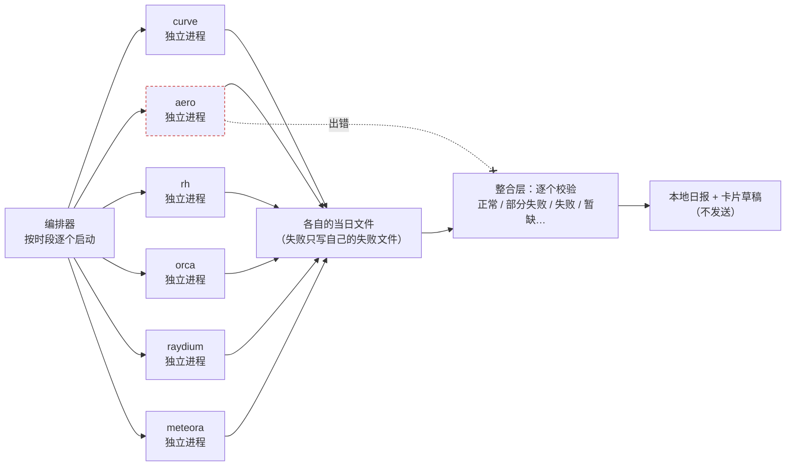
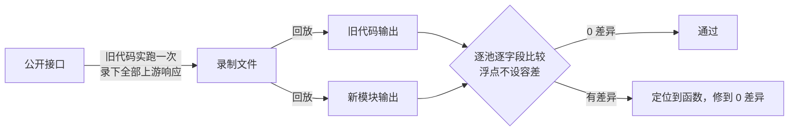
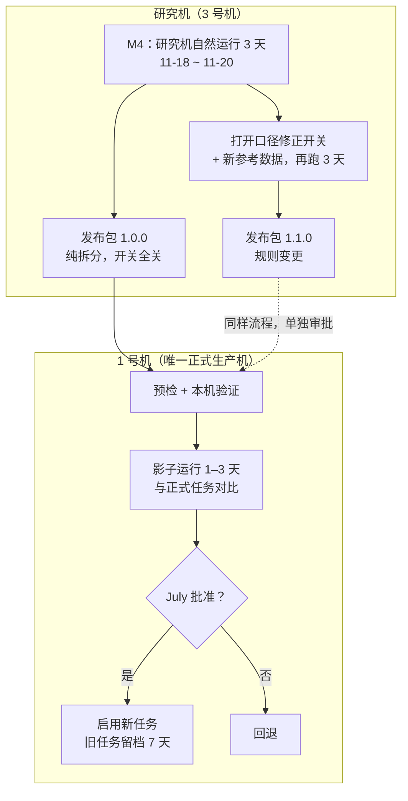

# LP 市场监控 3.0 · 模块化改造任务书

2026-11-18 · Julywa

3.0 第一阶段的采集写在一个 836 行的文件里，6 块市场分两个进程跑（08:20 三家、10:20 三家）。一家接口改了字段，同一进程里排在后面的几家当天都采不到。本任务把 6 块拆成 6 个独立模块，各自取数、筛选、出文件、记版本，再加一个只读的整合层，把 6 个模块的结果汇成一份日报草稿。规则和数据源都不改：同一份上游数据进新旧两套代码，输出必须逐字段相同。截至 11-17，拆分、整合层和发布包框架已完成，新旧输出 0 差异；研究机自然运行 11-18 开始，还没有交付 1 号机。1.0、2.0 不动。3.0 第一阶段的规则、数据源和验收见[《3.0 任务书》](lp-market-3.0-brief.md)，本文只写拆分。

## 当前状态（11-18）

| 关键结果 | 数字 |
| --- | --- |
| 新旧输出是否一致 | 6 个模块逐字段 **0 差异**（两个时段、232 条录制上游响应） |
| 一家出错是否影响其他家 | **不影响**：Orca 故障注入，只有 orca 失败 |
| 测试 | 68 个全过；旧代码原有 37 个仍全过 |
| 研究机首日（11-18） | 6 个模块全部正常；与 1 号机分类 100% 一致 |
| 下一步 | 11-20 交发布包 1.0.0（纯拆分） |

## 1. 范围一览

6 个模块对应 3.0 第一阶段的 6 块市场。一个模块只有一个排序数据源、一个采全比分母、一份输出文件。

| 模块 | 市场 | 排序数据源 | 时段 | 11-17 大池 / 过门槛 |
| --- | --- | --- | --- | --- |
| curve | Curve · Ethereum | Curve 官方 Prices API；TVL 用官方 getPools | 08:20 | 133 / 129 |
| aero | Aero 与 Aerodrome 旧版 · Base | GeckoTerminal | 08:20（与 rh 串行，aero 先） | 90 / 89 |
| rh | Robinhood 主流对（Aero、Ramses、Uniswap 等多家） | GeckoTerminal | 08:20 | 11 / 11 |
| orca | Orca · Solana | Orca 官方 API | 10:20 | 53 / 49 |
| raydium | Raydium · Solana | Raydium 官方 API | 10:20 | 171 / 61 |
| meteora | Meteora DLMM + DAMM v2 · Solana | Meteora 官方数据 API | 10:20 | 48 / 35 |

数据：研究机 11-17 用旧代码实跑并录制上游响应（stage1 约 12:38，stage2 约 12:37），新模块回放结果与之相同。

**每天怎么跑**

一个模块出错（虚线），整合层把它那一行标「失败」，其余 5 个照常汇总。

1. 时段开始，编排器按顺序逐个启动本时段的模块，每个模块一个子进程、一个超时。
2. 模块取数、筛选，写自己的输出文件和 meme 存档；出错只写自己的失败文件。
3. 编排器为每个模块写一份状态；任一模块失败或超时，整次运行以非 0 退出，交给外层任务走失败告警。
4. 时段结束，整合层读当天 6 个模块的文件，逐个校验，生成本地日报和卡片草稿（飞书卡片结构，标题带「影子/测试」）。整合层不能联网，也没有发送代码。

## 2. 为什么这么定

**为什么要拆。** 旧代码的主循环只拦「取数失败」一类异常。上游改字段会抛别的异常，整个进程退出，后面的数据源当天都没有产出。11-17 做了故障注入：Orca 的返回少一个字段，拆分后只有 orca 一个模块失败，raydium 照常产出。另外，6 块共用一套筛选函数，改一家的规则，另外五家都要重新验证。

**为什么拆成这 6 块。** 拆分的单位是「一个排序数据源 + 一个采全比分母」。

| 合在一起的 | 为什么不再拆 |
| --- | --- |
| Aero 与 Aerodrome 旧版 | 同一组 GeckoTerminal 请求，同一个 DefiLlama 分母。拆开请求翻倍，采全比算不出 |
| Meteora DLMM 与 DAMM v2 | 采全比分母 11-16 已统一成一个 |
| Robinhood 多家 DEX | 只采主流对，meme 规则（非股票、非主流币即存档）按链定 |

**为什么规则和数据源一律不改。** 先证明拆分本身不改行为，才能把「拆分」和「改规则」两类风险分开。阶段 1、2 的签收继续用 1 号机现有代码的产出，不受改造影响。规则或数据源要改，另走审批。

## 3. 数据源

3.0 没有网页抓取，全部是 JSON 接口或链上只读调用。三家 Solana 用官方 API；Aero 和 Robinhood 依赖第三方聚合 GeckoTerminal，是最不稳定的一块。

| 模块 | 用途 | 接口 | 性质 | 主要风险 |
| --- | --- | --- | --- | --- |
| curve | 成交、手续费、7 天、池列表 | prices.curve.finance | 官方 API | TVL 系统性偏高，已不用于 TVL |
| curve | TVL | api.curve.finance getPools | 官方 API，curve.fi 前端同源 | 字段随前端改版，没有版本承诺；失败时退回 Prices API 并告警 |
| curve | LP 分成 | ethereum-rpc.publicnode.com，`admin_fee()` | 链上只读，免费公共节点 | 限流；读不到按 50%，写明 |
| aero、rh | 池列表、TVL、成交 | api.geckoterminal.com | 第三方聚合 | 免费档限速；按成交只拉前 10 页；高周转池 TVL 低估；没有池级手续费 |
| orca | 全部字段 | api.orca.so | 官方 API | 大页静默截断，已用游标翻页 |
| raydium | 全部字段 | api-v3.raydium.io | 官方 API | 假 TVL 多，靠规则过滤 |
| meteora | 全部字段 | dlmm / damm-v2.datapi.meteora.ag | 官方 API | 没有 7 天字段 |
| 共享 | 采全比分母、能定价一侧 | api.llama.fi、coins.llama.fi | 第三方 | 只作分母，不参与排序 |
| 共享 | 股票名单、Solana 标签 | CoinGecko，运行时读本地缓存 | 第三方 | 缓存不会自动更新（见第 7 节） |

数据：接口清单来自代码逐行检查，11-17。

**GeckoTerminal 实测（11-17）。** Aero 模块请求 70 次，被限流 9 次；Robinhood 12 次，被限流 2 次，重试后都成功。同一批 Aero 池，研究机 12:38 与 1 号机 08:20 两次采集的 TVL 相差很大：AERO/cbBTC +120%、cbBTC/USDC +70%、AERO/USDC −27%。同期 Solana 三家官方接口的中位偏差只有 0.2%–1%。

**更稳的替代源（只评估，本任务不切换）。**

| 模块 | 现在 | 候选 | 现状 |
| --- | --- | --- | --- |
| aero | GeckoTerminal | Aero 官方 LpSugar 合约（Base 链上只读，含储备、费率、手续费） | 阶段 0 写过探针，未接入；本任务后另开任务书评估 |
| rh | GeckoTerminal | 没找到 Robinhood 链上覆盖多家 DEX 的官方接口 | 待确认 |

## 4. 拆分规则

| 规则 | 内容 |
| --- | --- |
| 进程隔离 | 每个模块单独起子进程，有自己的超时：curve 15 分钟、aero 25 分钟、其余 5 分钟（参考实测耗时）。模块里任何异常只记本模块失败 |
| 规则隔离 | 门槛、meme、过滤参数放在各模块的 `config.json`，初始值与 1 号机提交 fe9f8e2 完全相同。改一家只动这一家的文件 |
| 共享代码 | 只放不含业务规则的部分：请求与重试、读股票名单和标签缓存、采全比公式、格式校验。共享代码改动要升版本，并重跑 6 个模块的回放 |
| 输出格式 | 每个模块每天一个文件。summary 和 rows 与旧代码相同，另加追溯块：模块版本、提交号、状态（正常 / 部分失败 / 失败）、采集起止时间、各接口请求统计 |
| 失败 | 写失败文件（保留旧代码的四个字段），其余模块照常 |
| 版本 | 每个模块有自己的版本号和 git 标签，可单独回退 |
| 一致性判据 | 同一份录制的上游响应分别喂给新旧代码，summary、rows、meme 存档逐字段相同，浮点数不设容差 |
| 整合层 | 每个模块标一种状态：正常、部分失败、格式不符、失败、未到点、运行中、暂缺。一个模块出问题只影响自己那一行 |
| 运行目录 | 研究机：`out/lab/lp3`、`automation-lab`。1 号机影子：`out/lp3-shadow`、`automation-lp3m-shadow`。1 号机正式：`out/lp3`、`automation/lp3m-modules`。互不覆盖 |

## 5. 不做的事及原因

| 不做 | 原因 |
| --- | --- |
| 改门槛、meme、过滤、采全比规则 | 先证明拆分不改行为；规则改动另走审批 |
| 换数据源 | 同上；Aero 换 LpSugar 另开任务书评估 |
| 飞书推送、写表（含测试群） | 第一阶段只扩数据层；卡片、分榜和推送属于产品第二阶段 |
| 动 1.0、2.0 和共享依赖 `v3/` | 已正式运行，冻结 |
| 动 1 号机的代码、定时任务和状态 | 研究机只交发布包；1 号机预检、影子运行、July 批准后才启用 |
| 内部阶段 3 的收尾项 | 标签刷新、覆盖率重算、字段清单另有设计草稿，阶段 1 签收后开始 |
| 修旧代码的已知问题 | 拆分要求与旧代码行为一致；问题记在第 7 节，由 July 定 |

## 6. 阶段进度与验收

| 阶段 | 内容 | 判据 | 状态（11-17） |
| --- | --- | --- | --- |
| M0 任务书 | 范围、拆法、数据源标注 | July 确认 | 完成 |
| M1 骨架与工具 | 共享代码、输出格式、单模块运行、编排、录制回放与对比 | 原有测试仍通过；新工具有单测 | 完成 |
| M2 6 个模块 | 逐个迁移，各带测试 | 回放 0 差异；故障注入只影响一个模块 | 完成 |
| M3 整合层 | 读取、校验、标注、日报和卡片草稿 | 缺失、失败、格式不符都能正确标注 | 完成 |
| M4 研究机自然运行 | 两个研究机定时任务 | 连续 3 个自然日全部正常；与 1 号机同日对比的差异都能解释 | 进行中，11-18 首跑 |
| M5 发布包 | 打包、预检、安装、验证、启用、回退 | 校验和通过；默认不发送；不写死用户名；演练通过 | 框架完成，正式包等 M4 |

**怎么证明新旧一致**

录制回放走不到的分支（Meteora 7 天历史、Curve 前端失败退回、GeckoTerminal 全挂等），用 13 个差分测试补：同一份构造数据同时喂新旧代码，结果必须相同。

11-17 结果：

| 项 | 结果 |
| --- | --- |
| 测试 | 新测试 58 个全过；旧代码原有 37 个仍全过 |
| 回放一致性 | 两个时段共录制 232 条上游响应；6 个模块与旧代码逐字段 0 差异 |
| 实录没走到的分支 | 13 个差分测试：Meteora 实际 7 天手续费（11-19 起）、Curve getPools 失败退回、admin_fee 读不到、Aero 复查与 GeckoTerminal 全挂、Robinhood 动态费率与 meme 分流、Orca 翻页。新旧结果全部相同 |
| 研究机实跑 | 编排 3 个独立进程全部正常，状态文件正确；整合日报可用 6/6 |
| 与 1 号机同日对比 | 池子和分类基本一致。差集都在门槛边缘；TVL 中位偏差 0.1%–1%，大偏差只出现在 GeckoTerminal 的 Aero 池（第 3 节） |
| 发布包演练 | 用 1 号机生产快照的副本演练：预检通过；新模块和本机旧代码回放都 0 差异；没有 July 批准时拒绝启用；启用、回退都正常 |

## 7. 风险与已知限制

| 风险 | 影响 | 对策 |
| --- | --- | --- |
| 回放出现差异 | 拆分改了行为 | 定位到函数，修到 0 差异为止 |
| 研究机缺历史快照 | Aero 复查、Meteora 7 天、3 日均值算不对 | 用 1 号机 11-11 至 11-17 产出播种，来源记在 SEED-LOG |
| GeckoTerminal 限速 | aero、rh 抢额度 | 两者串行；1 号机影子 stage1 放 11:00，避开 08:20 正式任务和 08:50 的 2.0 |
| 1 号机代码在改造期间又改了 | 发布包基线过期 | 预检比对基线文件指纹，不同就停 |
| 1 号机正式代码在分支 `mvp2-stage3-4`，`main` 落后 | 发布包基线写错 | 发布包写明分支和提交号 |
| 标签缓存不会自动更新 | 新币被标「待分类」挡在榜外；11-17 Raydium 14 个代币不在缓存 | 阶段 2 签收条件：标签定期刷新列为内部阶段 3 第一项 |
| DefiLlama 返回格式异常 | 旧代码算采全比旧口径对照时崩溃，中断同进程后面所有数据源 | 新模块只让该模块失败；是否加类型检查待定（属行为变更） |
| 单日爆量门槛 | 3.0 任务书写「只挡 APY 榜」，代码实际整池不过门槛 | 拆分保持代码现状；产品第二阶段分榜时按任务书改，补测试 |
| curve.fi 页面有两个 TVL | 人工核对容易看错：标题来自 Prices API，资产明细来自链上余额，Yield Basis 池标题高 75% | 人工核对一律看资产明细合计（11-17 阶段 1 重抽） |

## 8. 下一步与时间表

| 事项 | 时间 |
| --- | --- |
| 研究机满 3 个自然日，与 1 号机同日对比无法解释的差异为 0 | 11-20 |
| **第一步**：打发布包 1.0.0（只做拆分，1.1.0 的开关全关，参考数据用基线），交 July | 11-20 |
| 1 号机预检、安装影子、本机验证；影子自然运行 1–3 天，与正式任务对比 | 11-21 至 11-23 |
| July 批准后启用，替换 `lp3-collect`、`lp3-stage2-collect`；旧任务 plist 留档至少 7 天 | 影子通过后 |
| **第二步**：研究机打开 raydium、rh、curve 1.1.0 的开关，并改用刷新后的标签和股票名单；连跑 3 天，与 1 号机对比，差异只应出现在这几项 | 11-21 起 |
| 打发布包 1.1.0，作为一次规则变更（APY 改为 LP 实收口径等）交 July 批准 | 第二步跑满 3 天后 |

待 July 定：旧代码 DefiLlama 返回格式异常的处理（第 7 节）。

## 9. 决策记录

| # | 问题 | 定了什么 | 现在是否有效 |
| --- | --- | --- | --- |
| 1 | 要不要拆 | 按 DEX 拆成独立模块，最后在飞书消息阶段整合；目的是故障隔离、问题定位、版本回溯 | 有效，11-17 |
| 2 | 1.0、2.0 | 稳定脚本不动 | 有效，11-17 |
| 3 | 数据获取 | 优先稳定 API，不用前端抓取；与前端耦合或第三方聚合的接口重点标注 | 有效，11-17，见第 3 节 |
| 4 | 开工条件 | 先出任务书，July 核对无误后开工 | 有效，11-17 |
| 5 | 拆法与整合 | 6 个模块；规则配置化；整合层只汇总 3.0；先签收后替换 | 有效，11-17 |
| 6 | Python | 研究机与 1 号机均为 3.9.6 | 有效，11-17 |
| 7 | 五项细节 | 目录 `lp3/`；研究机 2 个编排任务；LpSugar 另行评估；用 1 号机快照播种；已知问题按第 7 节处理 | 有效，11-17 |
| 8 | 研究机定时任务 | 同步历史后加载 `com.july.lab.lp3-stage1/2` | 有效，11-17 已加载 |
| 9 | 发布顺序 | 分两步：先发 1.0.0（纯拆分，行为与旧代码一致），再在研究机打开口径修正跑 3 天后发 1.1.0（规则变更，单独审批） | 有效，11-18 |

## 10. 需求核对（截至 11-17）

| 需求 | 状态 | 说明 |
| --- | --- | --- |
| 按 DEX 拆成独立模块 | 已完成 | 6 个模块，各有配置、版本、测试 |
| 一家出问题不影响其他家 | 已完成 | 故障注入和编排测试通过 |
| 方便定位和回溯 | 已完成 | 输出带模块版本、提交号、接口统计；每个模块单独打标签 |
| 规则和数据源不变 | 已完成 | 录制回放 0 差异 |
| 数据源稳定性标注 | 已完成 | 第 3 节 |
| 飞书消息阶段整合 | 部分完成 | 整合层和卡片草稿完成；推送属于产品第二阶段 |
| 1.0、2.0 不动 | 已完成 | 只新增 `lp3/` |
| 研究机连续 3 天自然运行 | 未完成 | 11-18 开始 |
| 发布包交付 1 号机 | 未开始 | 框架和演练已完成，等 M4 |
