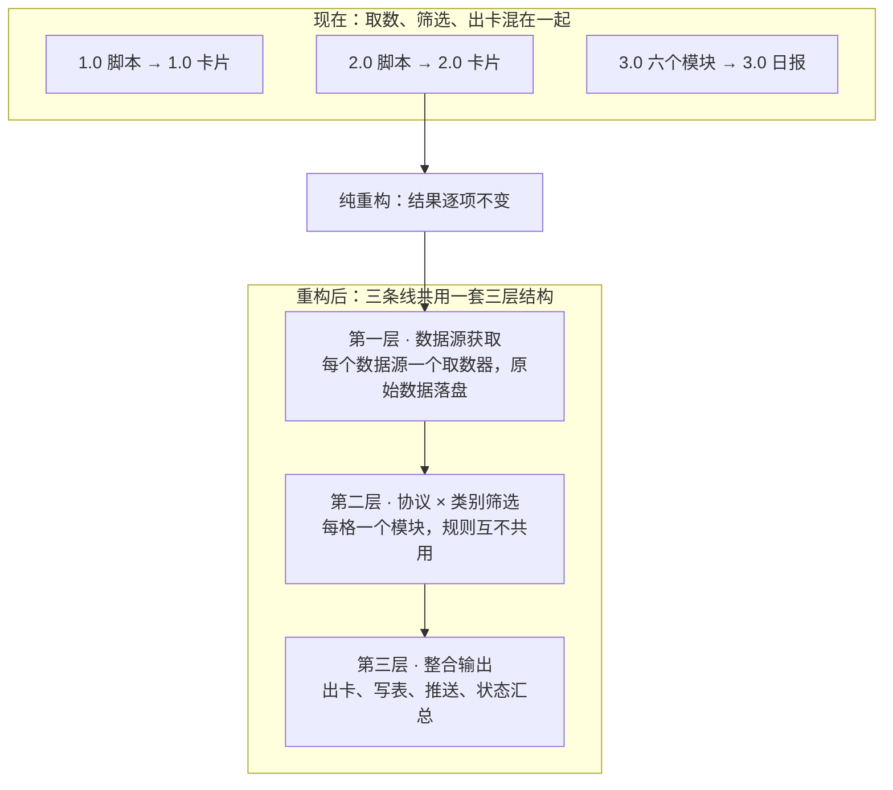
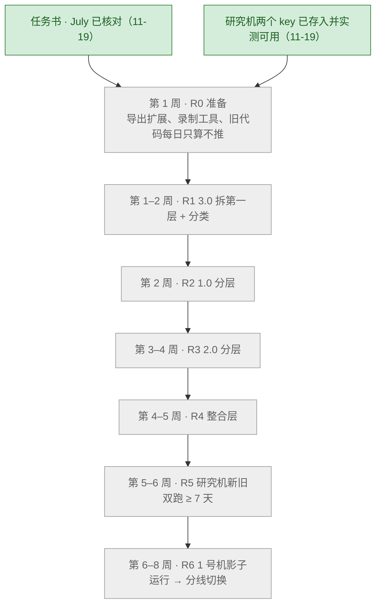
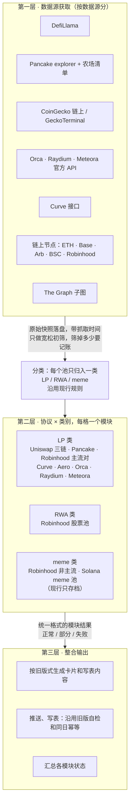
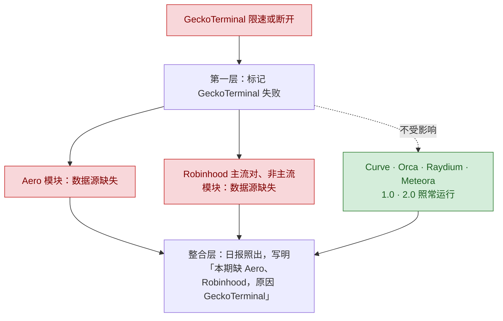
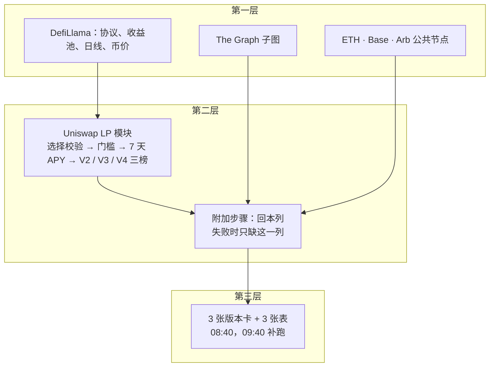
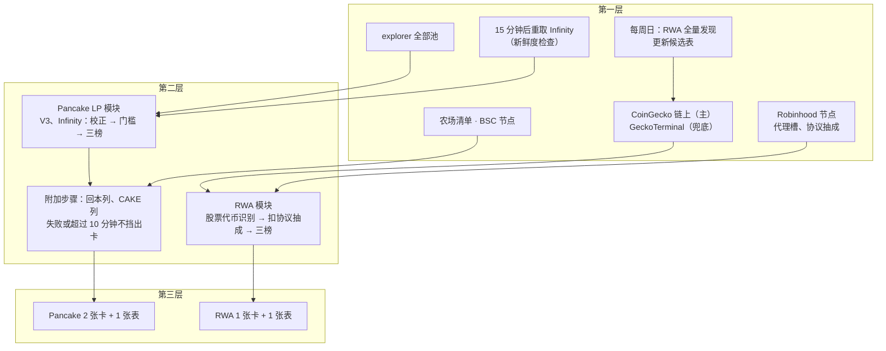
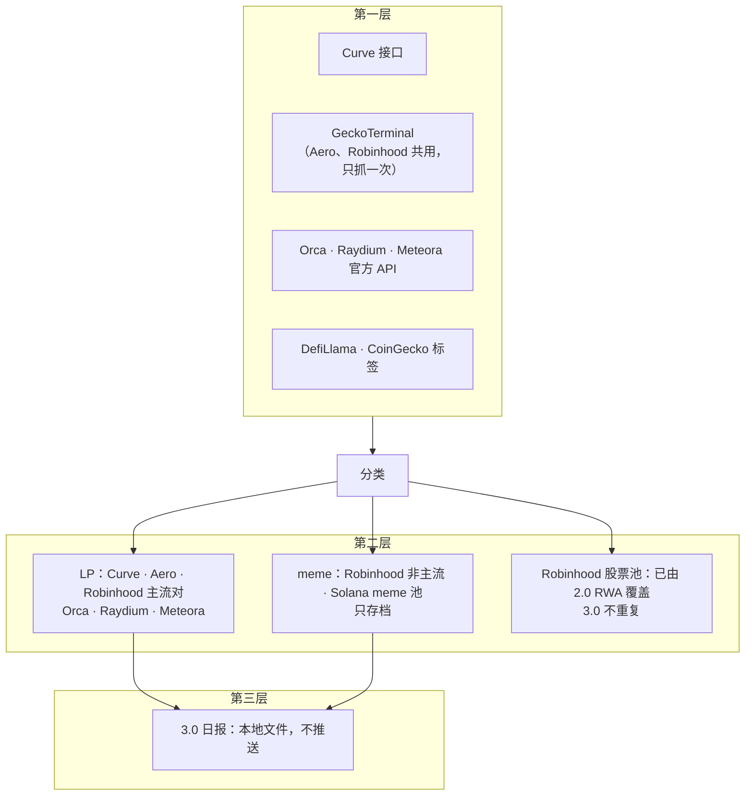
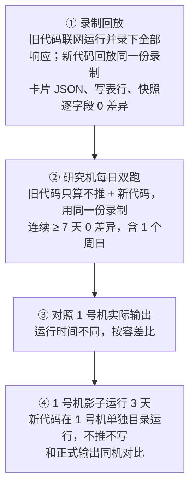
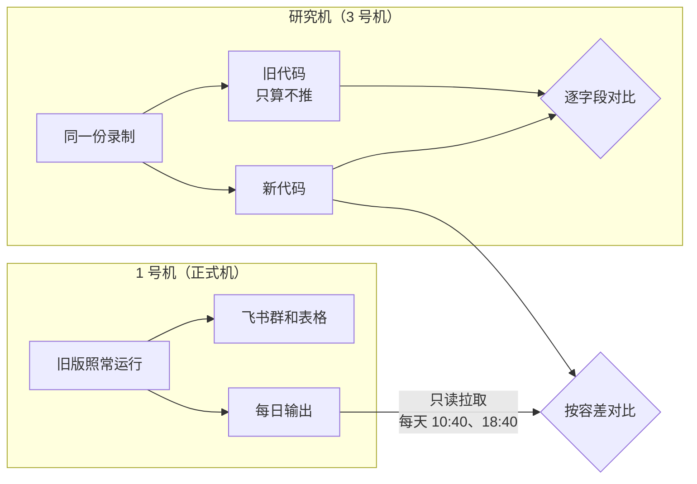
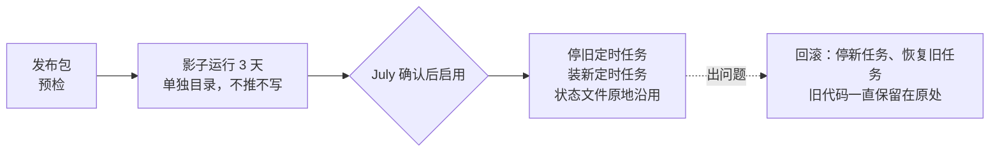

# LP 市场监控 · 三层分层重构任务书

2026-11-19 · Julywa · **July 已核对（11-19），11-20 起开工**

## 一页看懂

把 1.0、2.0、3.0 三条线统一拆成三层：

- **数据源获取**
- **各协议筛选**：同一协议内的 LP、RWA、meme 分开
- **整合输出**

这样拆有三个目的：

1. 任意一个数据源或协议出问题，只影响它自己、只告警它自己。
2. 接入新协议时，不碰已经稳定的代码。
3. 出问题能快速定位，并且能按模块回退版本。

| 要点 | 内容 |
| --- | --- |
| 原则 | **纯重构**：卡片、榜单、写表内容和现在逐项一致，规则一条不改 |
| 在哪做 | 研究机（3 号机）开发和测试。1 号机照常运行旧版，照常推送飞书 |
| 怎么换 | 新版证明和旧版一致后，**在 1 号机上把代码换成新版**，1 号机仍是唯一的正式机 |
| 怎么证明一致 | 旧代码和新代码读同一份录下的数据，逐字段对比，连续 7 天以上 0 差异 |
| 切换顺序 | 3.0 → 2.0 → 1.0，一次换一条，每条换完观察一周；出问题一条命令回到旧版 |
| 工作量 | 开发约 23–29 个工作日；从开工到全部切换约 6–8 周 |
| 不在本期 | 跨协议统一排序、LLM 解读：重构完成后作为新规则单独立项 |

## 当前状态与时间表（11-19）

| 项 | 现状 |
| --- | --- |
| 1.0、2.0 代码 | 研究机已有，与 1 号机现行版本相同。1 号机 11-17 之后只提交了 3.0 的文档 |
| 1.0、2.0 历史数据 | 研究机已有，截至 11-17 |
| 研究机密钥 | The Graph、CoinGecko 免费 key 各一个，11-19 存入并实测可用；与 1 号机的 key 分开。研究机**没有**飞书凭据 |
| 3.0 | 6 个协议模块已经拆好，相当于本任务的第二层。11-20 交付发布包 1.0.0 |
| 本任务 | 11-20 交付 3.0 发布包后开始 R0 |

## 1. 范围一览

| 线 | 现在的代码 | 1 号机定时任务 | 推飞书 | 本任务 |
| --- | --- | --- | --- | --- |
| 1.0 Uniswap 三链 | `mvp/`，约 1300 行 | 每天 08:40，09:40 补跑 | 3 张卡 + 3 张表 | 分三层，输出不变 |
| 2.0 Pancake、RWA | `mvp2/`，约 2600 行 | 每天 08:50，09:50 补跑；每周日 20:00 RWA 全量发现 | 3 张卡 + 2 张表 | 分三层，输出不变 |
| 3.0 六家 | `lp3/`，已模块化 | 每天 08:20、10:20 | 不推 | 补第一层和分类，输出不变 |
| 统一排序、LLM | 无 | — | — | **不做**，重构后单独立项 |

## 2. 为什么这么定

| 问题 | 决定 | 理由 |
| --- | --- | --- |
| 为什么在研究机重构，1 号机不动 | 新旧两套并行运行 | 1.0、2.0 每天推正式群，任何一天中断都看得见。新版在研究机上可以出错、返工，不影响日报 |
| 为什么换代码，不换机器 | 1 号机仍是正式机 | 1 号机上有飞书凭据、表格记录、回本缓存、每日备份和登记表，换代码时这些都不动。如果换成研究机做正式机，密钥和状态都要迁移，而且以后没有地方试验规则 |
| 为什么先做纯重构，不加新规则 | 先拆结构，再改规则 | 如果两件事同时做，结果有差异时分不清是重构出错，还是新规则的效果。分开做，每一步的差异来源都只有一个 |
| 为什么 LP、RWA、meme 分开 | 第二层按"协议 × 类别"拆 | 三类的筛选规则完全不同（11-19 July） |

**分层的收益，按线如实列出：**

| 收益 | 1.0 | 2.0 | 3.0 |
| --- | --- | --- | --- |
| 故障隔离 | 有限。DefiLlama 是唯一主源，它断了卡照样出不来；分层后，回本列等辅助数据失败会被明确标出 | 现在 Pancake 和 RWA 已经互不拖累；分层后 explorer、CoinGecko、BSC 节点各自独立标记 | 6 个模块已经独立；分层后共用的 GeckoTerminal 只抓一次、单独标记 |
| 接新协议 | 只加一个第二层模块，不碰旧模块 | 同左 | 同左 |
| 问题定位 | 原始数据落盘后，可以离线重跑筛选，不用重新联网 | 同左 | 同左 |

## 3. 三层怎么分

| 层 | 只负责 | 不许做 | 失败时 |
| --- | --- | --- | --- |
| 第一层 | 联网取数、重试、限速；原始快照落盘；宽松初筛 | 业务筛选、排序 | 该数据源标记失败，依赖它的模块读到"缺失" |
| 分类 | 每个池归入 LP、RWA、meme 中的一类 | 改分类规则 | 只影响被错分的池，当天分类统计里可见 |
| 第二层 | 读快照，执行该模块现行的门槛、APY、标记和三榜 | 联网（回本列、CAKE 列除外，见第 4 节） | 只有这个模块失败，其他模块照常 |
| 第三层 | 按旧版式出卡、写表、推送；补跑 | 改动任何模块的数字 | 和现在一样：卡片自检不过就不发残卡，任务失败就告警 |

### 举例：一个数据源断了会怎样

### 类别分开

同一协议内的 LP、RWA、meme 规则完全不同，因此各自是独立的模块，有自己的规则文件、版本号和状态。三类之间不共用门槛和 APY 口径。

| 类别 | 现行规则在哪 | 输出 |
| --- | --- | --- |
| LP | 1.0 说明；2.0 说明的 Pancake 部分；3.0 任务书 | 出卡，或进 3.0 日报 |
| RWA | 2.0 说明的 RWA 部分 | 出卡 |
| meme | 3.0 任务书：只存档，不排名 | 只存档。以后怎么用另行决定，与单独讨论的 meme 代币异动监控不是一件事 |

### 初筛规则

初筛的门槛必须比任何一个模块的门槛都松。例如 1.0 的池 TVL 门槛是 $50 万，初筛最多去掉 $1 万以下的池。被筛掉的数量每天记账。如果某个模块需要"前一天的大池"这类复核数据，初筛不能影响它。

## 4. 各线怎么拆

### 1.0 Uniswap 三链

**难点**：7 天 APY 依赖每天积累的日值缓存；日线补缺有时间预算，补缺本身就是取数，要放进第一层。

### 2.0 Pancake 与 RWA

**难点**：explorer 没有文档，5–15 分钟重算一次；CoinGecko 和 GeckoTerminal 的切换规则、每月 8000 次的额度计数、只增不删的候选表，都要原样保留。

### 3.0 六家

**难点**：3.0 已有录制回放工具和 0 差异证明，是三条线里最容易的。按类别拆分会多出 3–4 个模块。

**已知问题，本期不改**：3.0 现在的 meme 存档里混有 Raydium 的"假 TVL"池（未收录、低手续费），它们并不是 meme。本期只做纯重构，保持现状；把 meme 和假 TVL 拆清属于规则变更，放到重构之后。

**附加步骤**（回本列、CAKE 列）要按需读取链上数据，无法预先全量抓取。它们留在第二层模块内部，但必须使用第一层的取数工具（统一重试、计数、录制），并且失败时只让对应的列为空。

## 5. 怎么证明新旧一致

证据分四级，前一级通过才进入下一级。

- **主要证据是 ① 和 ②**：两套代码读同一份输入，不受时间和接口波动影响，因此要求逐字段一致。
- ③ 和 ④ 用来排除两台机器环境不同带来的问题，例如时区、代理、Python 版本（1 号机是 3.9.6）、节点能否连通。
- 旧代码在研究机上只算不推：1.0 加 `--no-feishu`；2.0 不加推送参数，也不放推送开关文件。写表请求由一个**假飞书**接住：只记录要写的行，不发出任何网络请求。

## 6. 两台机器怎么配合

| 事项 | 研究机（3 号机） | 1 号机 |
| --- | --- | --- |
| 运行 | 旧代码只算不推 + 新代码；定时任务全部用研究机专用名称 | 旧版照常推送，不动 |
| 推送和写表 | 永不推正式群、不写正式表 | 照常 |
| 密钥 | 自备的 The Graph 和 CoinGecko key；没有飞书凭据 | 不动 |
| 数据回传 | 每天拉取两次 | 导出范围加上 1.0/2.0 的每日快照，只读；July 在 1 号机执行一次扩展包 |
| 出口 IP | 如果和 1 号机相同，采集时间错开 30 分钟以上，避免限速额度翻倍 | — |

### 切换与回滚

**一次只换一条线**，每条线换完观察一周，再换下一条：

| 顺序 | 线 | 理由 |
| --- | --- | --- |
| 1 | 3.0 | 不推群，出问题影响最小 |
| 2 | 2.0 | 推群，有补跑槽位兜底 |
| 3 | 1.0 | 最老、最稳定，最后换 |

切换后，新代码原地读取现有状态文件（已推标记、表格 id、回本缓存、RWA 候选表等），不复制，确保同日不重复推送、补跑行为不变。切换安排在当天推送完成之后。

## 7. 不做的事及原因

| 不做 | 原因 |
| --- | --- |
| 改任何筛选、APY、门槛、版式 | 纯重构，要证明 0 差异 |
| 跨协议统一排序、LLM 解读 | 新规则，重构后单独立项；统一排序还要等 3.0 的 APY 口径统一（1.1.0） |
| 改变告警粒度 | 本期告警和现在一样：任务失败就告警。按模块细分会改变告警群收到的消息，切换完成后作为单独的小改动提出 |
| 研究机推送或写表 | 双机规则 |
| 把正式机换成研究机 | 11-19 July 定：换代码，不换机器 |
| 删除旧代码、旧定时任务模板 | 回滚要用 |

## 8. 阶段与验收

| 阶段 | 内容 | 判据 | 开发 |
| --- | --- | --- | --- |
| R0 准备 | 1 号机导出扩展包；录制工具覆盖 1.0/2.0 的取数方式；假飞书；研究机开始每天运行旧代码（只算不推） | 旧代码在研究机连续 2 天跑通，录制完整 | 2–3 天 |
| R1 3.0 第一层 + 分类 | 从 6 个模块中抽出取数器；共用数据源只抓一次；独立分类步骤；按类别拆出 meme 模块 | 录制回放 0 差异；分类结果与现行 100% 一致；现有 68 个测试通过 | 4–5 天 |
| R2 1.0 分层 | DefiLlama 等取数器；Uniswap 模块；回本附加步骤 | 录制回放：3 张卡 JSON、3 张表的行、快照 0 差异 | 3–4 天 |
| R3 2.0 分层 | explorer（含 15 分钟重取）、CoinGecko/GeckoTerminal 切换、BSC 和 Robinhood 节点；Pancake 与 RWA 模块；周日全量发现 | 录制回放：3 张卡 JSON、2 张表的行、快照 0 差异；额度计数一致 | 6–8 天 |
| R4 整合层 | 统一模块结果格式；按线出卡、写表、推送（沿用旧版自检和同日幂等）；汇总模块状态 | 断开任一数据源，只有依赖它的模块失败，其余卡照常生成 | 4–5 天 |
| R5 双跑 | 研究机每天新旧两套用同一份录制运行 | 连续 ≥ 7 天 0 差异，含 1 个周日；与 1 号机实际输出在容差内 | 自然运行 |
| R6 切换 | 每条线：发布包 → 影子运行 3 天 → July 确认 → 切换 → 观察一周 | 影子与正式输出同机对比在容差内；切换后首周推送无异常 | 每条线约 2 天 |

**合计开发约 23–29 个工作日。** 加上双跑、影子运行和分线观察，从开工到三条线全部切换约 **6–8 周**。

## 9. 风险

| 风险 | 影响 | 对策 |
| --- | --- | --- |
| 旧代码里有没写进文档的边界处理，被漏掉 | 某天新旧结果不同 | 录制回放逐字段比对；双跑 ≥ 7 天，覆盖每周任务 |
| 初筛误杀 | 模块需要的池被提前丢掉 | 初筛门槛比所有模块都松；每天记账；加测试 |
| 两台机器环境不同 | 研究机通过、1 号机出错 | 新代码只用 Python 标准库，兼容 3.9.6；1 号机影子运行 3 天 |
| 接口额度翻倍 | 两台机器同时调用，触发限速 | 研究机用自己的 key；采集时间错开 |
| 并行期间 1 号机旧版有改动 | 新旧不再可比 | 1.0/2.0 冻结；如果改了，同步移植到新版，重做 ① |
| 切换当天状态不连续 | 重复推卡或漏推 | 状态文件原地沿用；切换安排在当天推送完成之后 |
| 与 3.0 的 1.1.0 规则变更交叉 | 证据混在一起 | 重构在单独分支开发；1.1.0 先上线，重构以上线后的版本为基础 |
| 工作量估计偏差 | 2.0 的 explorer 和 RWA 切换逻辑最复杂 | 先做 R1、R2，按实际用时重估 R3 |

## 10. 已定事项（11-19）

| # | 事项 | 结论 | 状态 |
| --- | --- | --- | --- |
| 1 | 本次是否只做纯重构 | 是，规则一条不改 | 已定 |
| 2 | 是否建测试飞书群 | 先不建，对比文件即可；切换前如果想看真实卡片再建 | 已定 |
| 3 | 研究机自备 The Graph 和 CoinGecko key | 是，不复用 1 号机的 key | **已完成**，11-19 存入并实测可用 |
| 4 | 1 号机导出范围扩展到 1.0/2.0 每日快照 | 同意；我出扩展包，July 在 1 号机执行一次 | R0 交付 |
| 5 | 切换顺序 | 3.0 → 2.0 → 1.0，每条间隔一周 | 已定 |
| 6 | 开工时间 | 11-20 交付 3.0 发布包 1.0.0 之后开始 R0 | 已定 |

## 11. 决策记录

| # | 日期 | 决定 | 出处 |
| --- | --- | --- | --- |
| 1 | 11-19 | 1.0、2.0、3.0 统一拆成数据源、协议筛选、整合三层；目的是故障隔离、单模块告警、新协议不碰旧代码 | July |
| 2 | 11-19 | 研究机开发和测试，1 号机旧版照常推送；新版通过后**换代码，1 号机仍是正式机** | July |
| 3 | 11-19 | 同一协议内 LP、RWA、meme 三类规则完全不同，各自分开；第二层按"协议 × 类别"拆模块 | July |
| 4 | 11-19 | 第 10 节 6 项全部按建议 | July「按建议来」 |
| 5 | 11-19 | 研究机两个 key 已存入 Keychain，实测可用 | July 存入，Claude 核对 |
