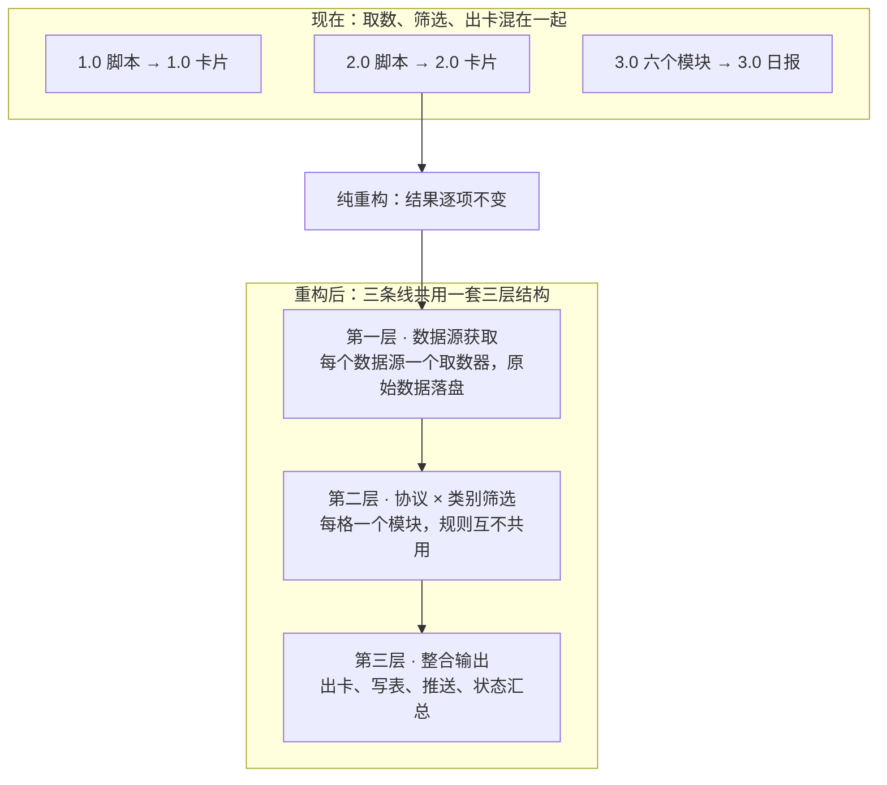
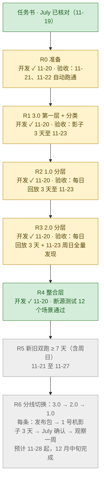
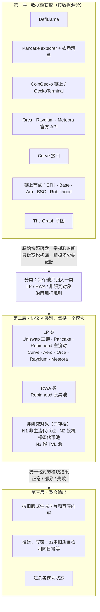
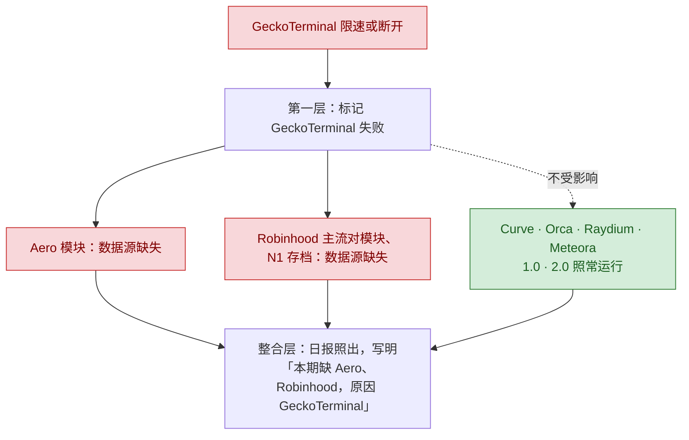
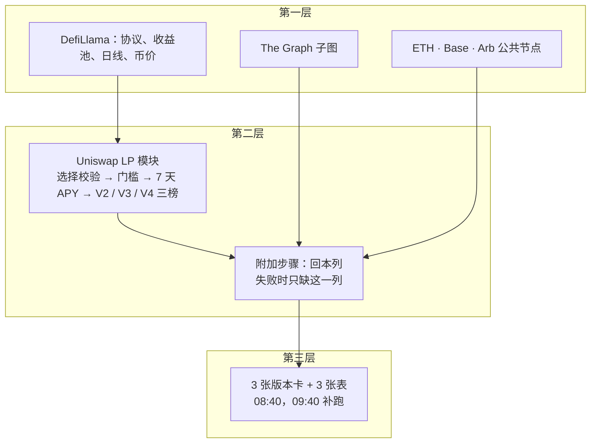
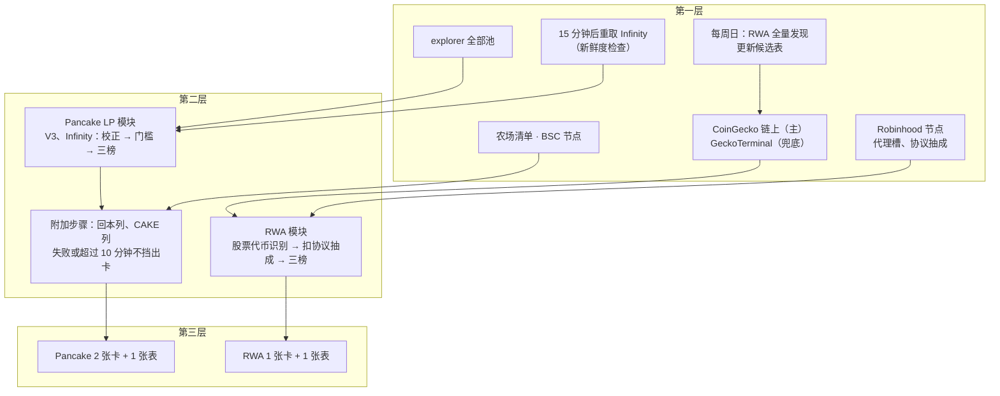
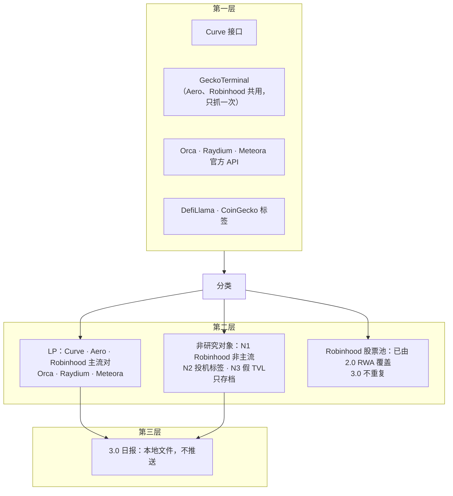
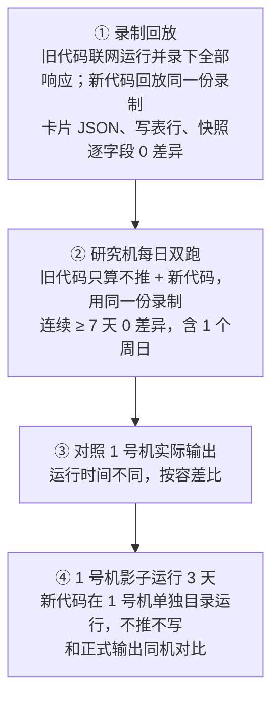
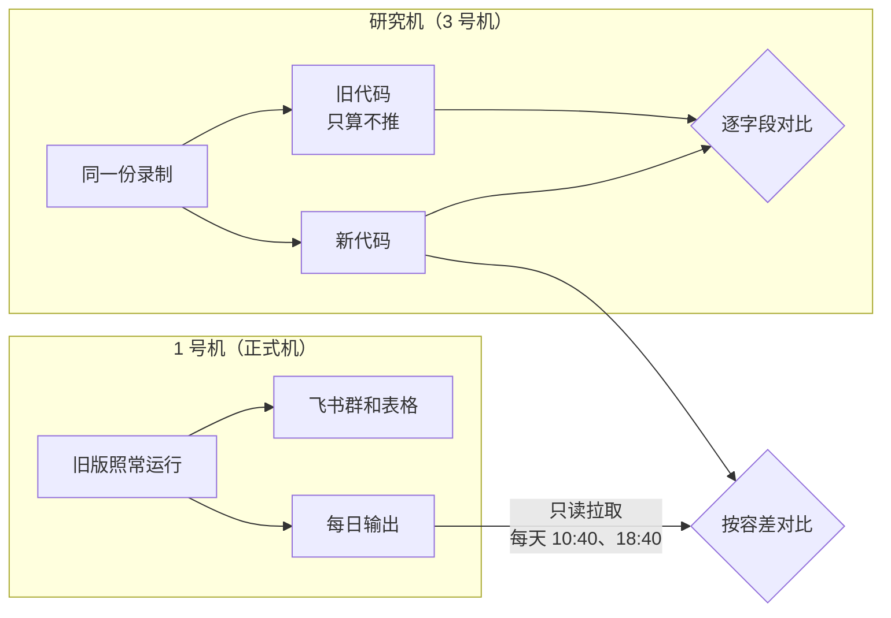
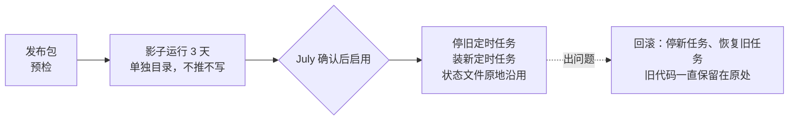

# LP 市场监控 · 三层分层重构任务书

2026-11-19 · Julywa · July 已核对（11-19）· **11-20 更新：R0–R4 开发完成，进入验收；R5 双跑 11-21 开始**

## 一页看懂

把 1.0、2.0、3.0 三条线统一拆成三层：

- **数据源获取**
- **各协议筛选**：研究对象只有 LP 和 RWA，各自独立；其余池是非研究对象，只存档
- **整合输出**

这样拆有三个目的：

1. 任意一个数据源或协议出问题，只影响它自己、只告警它自己。
2. 接入新协议时，不碰已经稳定的代码。
3. 出问题能快速定位，并且能按模块回退版本。

| 要点 | 内容 |
| --- | --- |
| 研究对象 | **LP、RWA**；MEME 是独立支线，不在本项目；其余池是**非研究对象**，只存档（N1 非主流代币池、N2 投机标签代币池、N3 假 TVL 池） |
| 原则 | **纯重构**：卡片、榜单、写表内容和现在逐项一致，规则一条不改。唯一例外是 July 11-20 批准的决策 #7（RWA 空卡不推），只在故障时生效 |
| 在哪做 | 研究机（3 号机）开发和测试。1 号机照常运行旧版，照常推送飞书 |
| 怎么换 | 新版证明和旧版一致后，**在 1 号机上把代码换成新版**，1 号机仍是唯一的正式机 |
| 怎么证明一致 | 旧代码和新代码读同一份录下的数据，逐字段对比，连续 7 天以上 0 差异 |
| 切换顺序 | 3.0 → 2.0 → 1.0，一次换一条，每条换完观察一周；出问题一条命令回到旧版 |
| 工作量 | 原估开发 23–29 个工作日；**实际 R0–R4 在 11-20 一天内完成开发**（多数代码能原样搬家）。剩下的时间主要是自然运行的验收和分线切换，全部切换预计约 **4 周**（12 月中旬） |
| 不在本期 | 跨协议统一排序、LLM 解读：重构完成后作为新规则单独立项。覆盖率三项补充（Aero 官方数据源、Uniswap · BSC、RWA 跨链汇总）同样排在切换之后，见 [3.0 任务书](lp-market-3.0-brief.md)第 8 节 |

## 当前状态与时间表（11-20）

| 项 | 现状（11-20） |
| --- | --- |
| 代码 | 新代码在研究机的独立开发目录（分支 `refactor/r1`），研究机每天的定时任务、1.1.0 试跑、1 号机发布包都不受影响 |
| 1 号机 | 1.0、2.0 旧版照常推送；3.0 模块化 1.0.1 正在影子运行（11-21 至 11-23），与本任务的 R6 是两件事 |
| 研究机每天自动做的事 | 08:40、08:50 运行 1.0/2.0 旧代码并录制 → 立刻用新代码回放比对；10:25、11:15 跑 3.0 新代码影子；10:40、18:40 从 1 号机拉取后自动对比、查磁盘；周日 20:05 录 RWA 全量发现 |
| 研究机密钥 | The Graph、CoinGecko 免费 key 各一个；研究机**没有**飞书凭据，回放时再加一道拦截，读飞书密钥一律拒绝 |
| 需要 July 做的 | 无。11-23 晚交验收报告 |

## 进度与证据（11-20）

| 阶段 | 做了什么 | 证据 | 还剩 |
| --- | --- | --- | --- |
| R0 准备 | 1 号机导出扩展（v3）生效；研究机每天跑 1.0/2.0 旧代码只算不推；多进程录制回放工具（密钥脱敏、时间戳归一）；假飞书 | 1.0、2.0 回放与实跑逐文件相同（1.0 6 个、2.0 18 个文件，含表格写入） | 11-21、11-22 自动跑通 |
| R1 3.0 第一层 + 分类 | 6 个取数器（DefiLlama 一个时段只拉一次、GeckoTerminal 统一限速）；分类独立成一步；非研究对象存档改名并标 N1–N3 | 11-17 录制回放 6 个模块 0 差异；历史重分类 11-17 起 100% 一致（1 号机 2380 池次）；GeckoTerminal 断开只影响 aero、rh | 研究机影子 3 天 |
| R2 1.0 分层 | 第一层（DefiLlama 两张大表，初筛去掉 TVL < $1 万的 183 池）、第二层（Uniswap 模块）、第三层（出卡写表） | 3 张卡 JSON、3 张表 198 行、快照、缓存 0 差异 | 每日回放 3 天 |
| R3 2.0 分层 | Pancake、RWA 各自三层；RWA 函数零改动按层搬家 | 3 张卡、Pancake 120 行 + RWA 60 行表格、快照、CoinGecko 额度计数 0 差异 | 每日回放 3 天；11-23 周日全量发现回放 |
| R4 整合层 | 1.0、2.0 共用一套发送（自检、关键词、同日幂等）；真 / 假写表与推送；三条线状态汇总；磁盘用量提示 | 回放 0 差异，假推送的卡与卡片文件逐字节相同；**12 个断源场景，只有依赖该源的模块失败，其余卡照常推** | 并入 R5 |

各阶段的设计文档、断源测试原始结果和代码审计报告留在研究机，需要时可以单独导出。

## 1. 范围一览

| 线 | 现在的代码 | 1 号机定时任务 | 推飞书 | 本任务 |
| --- | --- | --- | --- | --- |
| 1.0 Uniswap 三链 | `mvp/`，约 1300 行 | 每天 08:40，09:40 补跑 | 3 张卡 + 3 张表 | 分三层，输出不变 |
| 2.0 Pancake、RWA | `mvp2/`，约 2600 行 | 每天 08:50，09:50 补跑；每周日 20:00 RWA 全量发现 | 3 张卡 + 2 张表 | 分三层，输出不变 |
| 3.0 六家 | `lp3/`，已模块化 | 每天 08:20、10:20 | 不推 | 补第一层和分类，输出不变 |
| 统一排序、LLM | 无 | — | — | **不做**，重构后单独立项 |

## 2. 为什么这么定

| 问题 | 决定 | 理由 |
| --- | --- | --- |
| 为什么在研究机重构，1 号机不动 | 新旧两套并行运行 | 1.0、2.0 每天推正式群，任何一天中断都看得见。新版在研究机上可以出错、返工，不影响日报 |
| 为什么换代码，不换机器 | 1 号机仍是正式机 | 1 号机上有飞书凭据、表格记录、回本缓存、每日备份和登记表，换代码时这些都不动。如果换成研究机做正式机，密钥和状态都要迁移，而且以后没有地方试验规则 |
| 为什么先做纯重构，不加新规则 | 先拆结构，再改规则 | 如果两件事同时做，结果有差异时分不清是重构出错，还是新规则的效果。分开做，每一步的差异来源都只有一个 |
| 为什么 LP、RWA 分开，非研究对象单列 | 第二层按"协议 × 类别"拆 | LP 和 RWA 的筛选规则完全不同；被排除的池不是研究对象，也和 MEME 支线不是一回事（11-19 July） |

**分层的收益，按线如实列出：**

| 收益 | 1.0 | 2.0 | 3.0 |
| --- | --- | --- | --- |
| 故障隔离 | 有限。DefiLlama 是唯一主源，它断了卡照样出不来；分层后，回本列等辅助数据失败会被明确标出 | 现在 Pancake 和 RWA 已经互不拖累；分层后 explorer、CoinGecko、BSC 节点各自独立标记 | 6 个模块已经独立；分层后共用的 GeckoTerminal 只抓一次、单独标记 |
| 接新协议 | 只加一个第二层模块，不碰旧模块 | 同左 | 同左 |
| 问题定位 | 原始数据落盘后，可以离线重跑筛选，不用重新联网 | 同左 | 同左 |

## 3. 三层怎么分

| 层 | 只负责 | 不许做 | 失败时 |
| --- | --- | --- | --- |
| 第一层 | 联网取数、重试、限速；原始快照落盘；宽松初筛 | 业务筛选、排序 | 该数据源标记失败，依赖它的模块读到"缺失" |
| 分类 | 每个池归入 LP、RWA、非研究对象中的一类 | 改分类规则 | 只影响被错分的池，当天分类统计里可见 |
| 第二层 | 读快照，执行该模块现行的门槛、APY、标记和三榜 | 联网（回本列、CAKE 列除外，见第 4 节） | 只有这个模块失败，其他模块照常 |
| 第三层 | 按旧版式出卡、写表、推送；补跑 | 改动任何模块的数字 | 和现在一样：卡片自检不过就不发残卡，任务失败就告警 |

### 举例：一个数据源断了会怎样

### 研究对象与非研究对象

本项目只研究 **LP** 和 **RWA**。**MEME** 是独立支线，研究代币早期的链上异动，不在本项目。LP 和 RWA 的规则完全不同，各自是独立模块，有自己的规则文件、版本号和状态，不共用门槛和 APY 口径。

被排除的池统一叫**非研究对象**（过去文档里叫"meme"，和 MEME 支线不是一回事），只存档、不上榜。按排除原因分三类，判定规则沿用现行。完整说明见 [3.0 任务书](lp-market-3.0-brief.md)第 4 节。

| 类别 | 判定规则 | 为什么不研究 | 输出 |
| --- | --- | --- | --- |
| LP | 1.0 说明；2.0 说明的 Pancake 部分；3.0 任务书 | — | 出卡，或进 3.0 日报 |
| RWA | 2.0 说明的 RWA 部分 | — | 出卡 |
| N1 非主流代币池 | Robinhood：两侧都不是主流币，也不是股票、ETF、商品代币 | 长尾代币的价格波动决定 LP 盈亏，APY 不代表可得收益；TVL 数据大量为 0 | 只存档 |
| N2 投机标签代币池 | Solana：任一侧被 CoinGecko 归入 meme 类别 | 同上；而且存档的是大池和老池，不是 MEME 支线要看的早期代币 | 只存档 |
| N3 假 TVL 池 | Solana：未被 CoinGecko 收录，且 7 天手续费 ÷ TVL < 0.01% | 资金几乎不产生手续费，TVL 无法核实 | 只存档 |

### 初筛规则

初筛的门槛必须比任何一个模块的门槛都松。例如 1.0 的池 TVL 门槛是 $50 万，初筛最多去掉 $1 万以下的池。被筛掉的数量每天记账。如果某个模块需要"前一天的大池"这类复核数据，初筛不能影响它。

**实际执行（11-20）**：

| 线 | 初筛 | 原因 |
| --- | --- | --- |
| 1.0 收益池表 | 去掉 TVL < $1 万的池（11-20：15042 池中 183 个，合计约 $60 万）；**先按 项目×链 计数再筛** | 选链要数全部池；有单元测试证明选链结果不变 |
| 1.0 协议表 | 不按 TVL 筛，只留用到的 6 个字段（9.4 MB → 0.4 MB） | 要算全部 DEX 的 TVL 份额 |
| 3.0 | 不筛，只记账 | aero 的采全比要累计门槛下长尾、rh 的 N1 存档不设 TVL 门槛；三家 Solana 官方 API 本来就只拉到门槛为止 |
| 2.0 | 不筛 | explorer、RWA 候选表本来就是逐池取，没有大表 |

## 4. 各线怎么拆

### 1.0 Uniswap 三链

**难点**：7 天 APY 依赖每天积累的日值缓存；日线补缺有时间预算，补缺本身就是取数，要放进第一层。

### 2.0 Pancake 与 RWA

**难点**：explorer 没有文档，5–15 分钟重算一次；CoinGecko 和 GeckoTerminal 的切换规则、每月 8000 次的额度计数、只增不删的候选表，都要原样保留。

### 3.0 六家

**难点**：3.0 已有录制回放工具和 0 差异证明，是三条线里最容易的。按类别拆分会多出 3–4 个模块。

**非研究对象存档改名**：现在三类混在一个 `meme-<模块>-<日期>.json` 文件里，字段也叫 `meme_label`。R1 中把文件和字段改名，并给每个池标上 N1、N2 或 N3，存档里的池和数字不变。这是本期唯一的输出改名，不涉及卡片和表格。**11-20 已完成**：`nonresearch-<模块>-<日期>.json`、`token_label`、每行 `nr_class`；主输出每行另加 `research_class`（LP / RWA / N1 / N2 / N3 / 待分类）。

**附加步骤**（回本列、CAKE 列）要按需读取链上数据，无法预先全量抓取。它们留在第二层模块内部，但必须使用第一层的取数工具（统一重试、计数、录制），并且失败时只让对应的列为空。

**实际拆分时的调整（11-20）**：凡是"请求名单取决于当天筛选结果"的取数，都和回本列一样作为按需步骤留在第二层，原因是新旧代码要发出完全相同的请求才能逐字比对。包括：1.0 的协议抽成链上读、7 天日线回填；3.0 的 Curve 7 天成交和链上费率、Aero 复查、Raydium 定价、Robinhood 协议抽成；2.0 的 RWA 协议抽成和股票代币识别。

## 5. 怎么证明新旧一致

证据分四级，前一级通过才进入下一级。

- **主要证据是 ① 和 ②**：两套代码读同一份输入，不受时间和接口波动影响，因此要求逐字段一致。
- ③ 和 ④ 用来排除两台机器环境不同带来的问题，例如时区、代理、Python 版本（1 号机是 3.9.6）、节点能否连通。
- 旧代码在研究机上只算不推：1.0 加 `--no-feishu`；2.0 不加推送参数，也不放推送开关文件。写表请求由一个**假飞书**接住：只记录要写的行，不发出任何网络请求。

**已拿到的证据（11-20）**：

| 级别 | 状态 |
| --- | --- |
| ① 录制回放 | 1.0、2.0、3.0 全部 0 差异（见"进度与证据"） |
| ② 每日双跑 | 研究机已自动化：每天录完旧代码立刻用新代码回放，结果每天写成回放报告；3.0 走影子对比。11-21 起累计 |
| 断源测试（R4 验收） | 回放时把指定主机的请求按"连不上"处理（故障注入），12 个场景全部符合"只有依赖它的模块失败" |
| ③④ | R6 时做 |

**回放工具的安全设计**：录制钩子启用失败时进程直接退出，绝不在没有拦截的情况下运行（11-20 断源测试发现并行进程会把计数文件写坏，旧版钩子此时会悄悄走真实网络，已修）。

## 6. 两台机器怎么配合

| 事项 | 研究机（3 号机） | 1 号机 |
| --- | --- | --- |
| 运行 | 旧代码只算不推 + 新代码；定时任务全部用研究机专用名称 | 旧版照常推送，不动 |
| 推送和写表 | 永不推正式群、不写正式表 | 照常 |
| 密钥 | 自备的 The Graph 和 CoinGecko key；没有飞书凭据 | 不动 |
| 数据回传 | 每天拉取两次 | 导出范围加上 1.0/2.0 的每日快照，只读；**11-20 July 已在 1 号机执行扩展包（v3）** |
| 出口 IP | 如果和 1 号机相同，采集时间错开 30 分钟以上，避免限速额度翻倍 | — |

### 切换与回滚

**一次只换一条线**，每条线换完观察一周，再换下一条：

| 顺序 | 线 | 理由 |
| --- | --- | --- |
| 1 | 3.0 | 不推群，出问题影响最小 |
| 2 | 2.0 | 推群，有补跑槽位兜底 |
| 3 | 1.0 | 最老、最稳定，最后换 |

切换后，新代码原地读取现有状态文件（已推标记、表格 id、回本缓存、RWA 候选表等），不复制，确保同日不重复推送、补跑行为不变。切换安排在当天推送完成之后。

## 7. 不做的事及原因

| 不做 | 原因 |
| --- | --- |
| 改任何筛选、APY、门槛、版式 | 纯重构，要证明 0 差异。唯一例外：决策 #7（RWA 空卡不推），只在两个数据源都断时生效，正常日回放不受影响 |
| 跨协议统一排序、LLM 解读 | 新规则，重构后单独立项；统一排序还要等 3.0 的 APY 口径统一（1.1.0） |
| 改变告警粒度 | 本期告警和现在一样：任务失败就告警。按模块细分会改变告警群收到的消息，切换完成后作为单独的小改动提出 |
| 研究机推送或写表 | 双机规则 |
| 把正式机换成研究机 | 11-19 July 定：换代码，不换机器 |
| 删除旧代码、旧定时任务模板 | 回滚要用 |
| 删除原始数据、录制、拉取数据 | 11-20 July 定：全部保留；磁盘用量超过一半时再提保留期方案 |
| 统一 9 套 HTTP 取数、2 套录制工具等结构性冗余 | 统一会改变请求方式和重试节奏，回放就不再 0 差异；切换完成后单独做（审计 L1–L5） |

## 8. 阶段与验收

| 阶段 | 内容 | 判据 | 原估 | 实际（11-20） |
| --- | --- | --- | --- | --- |
| R0 准备 | 1 号机导出扩展；录制工具覆盖 1.0/2.0；假飞书；研究机每天运行旧代码（只算不推） | 旧代码在研究机连续 2 天跑通，录制完整 | 2–3 天 | 开发完成；验收 11-21、11-22 |
| R1 3.0 第一层 + 分类 | 取数器；共用数据源只抓一次；独立分类步骤；非研究对象改名并标 N1–N3 | 录制回放 0 差异；分类结果与现行 100% 一致；现有测试通过 | 4–5 天 | 开发完成，回放 0 差异、分类 100%；影子验收至 11-23 |
| R2 1.0 分层 | DefiLlama 等取数器；Uniswap 模块；回本附加步骤 | 录制回放：3 张卡 JSON、3 张表的行、快照 0 差异 | 3–4 天 | 开发完成，0 差异；每日回放至 11-23 |
| R3 2.0 分层 | explorer（含 15 分钟重取）、CoinGecko/GeckoTerminal 切换、BSC 和 Robinhood 节点；Pancake 与 RWA 模块；周日全量发现 | 录制回放：3 张卡 JSON、2 张表的行、快照 0 差异；额度计数一致 | 6–8 天 | 开发完成，0 差异、额度计数一致；周日全量发现 11-23 回放 |
| R4 整合层 | 统一模块结果格式；按线出卡、写表、推送（沿用旧版自检和同日幂等）；汇总模块状态 | 断开任一数据源，只有依赖它的模块失败，其余卡照常生成 | 4–5 天 | **已通过**（12 个断源场景） |
| R5 双跑 | 研究机每天新旧两套用同一份录制运行 | 连续 ≥ 7 天 0 差异，含 1 个周日；与 1 号机实际输出在容差内 | 自然运行 | 11-21 至 11-27 |
| R6 切换 | 每条线：发布包 → 影子运行 3 天 → July 确认 → 切换 → 观察一周 | 影子与正式输出同机对比在容差内；切换后首周推送无异常 | 每条线约 2 天 | 预计 11-28 起：3.0 → 2.0 → 1.0 |

**原估合计开发 23–29 个工作日；实际 R0–R4 开发 1 天。** 原因：旧代码的函数边界本来清楚，多数能原样搬家，只在取数边界改几行；验收全部靠录制回放自动完成。剩下的时间是自然运行和分线观察，不再受开发量影响。

## 9. 风险

| 风险 | 影响 | 对策 |
| --- | --- | --- |
| 旧代码里有没写进文档的边界处理，被漏掉 | 某天新旧结果不同 | 录制回放逐字段比对；双跑 ≥ 7 天，覆盖每周任务 |
| 初筛误杀 | 模块需要的池被提前丢掉 | 初筛门槛比所有模块都松；每天记账；加测试 |
| 两台机器环境不同 | 研究机通过、1 号机出错 | 新代码只用 Python 标准库，兼容 3.9.6；1 号机影子运行 3 天 |
| 接口额度翻倍 | 两台机器同时调用，触发限速 | 研究机用自己的 key；采集时间错开 |
| 并行期间 1 号机旧版有改动 | 新旧不再可比 | 1.0/2.0 冻结；如果改了，同步移植到新版，重做 ① |
| 切换当天状态不连续 | 重复推卡或漏推 | 状态文件原地沿用；切换安排在当天推送完成之后 |
| 与 3.0 的 1.1.0 规则变更交叉 | 证据混在一起 | 重构在单独分支开发；1.1.0 先上线，重构以上线后的版本为基础 |
| 工作量估计偏差 | 2.0 的 explorer 和 RWA 切换逻辑最复杂 | **已解除**：R3 半天完成（RWA 函数零改动搬家） |
| 回放工具误走真实网络 | 证据失真，研究机可能产生真实请求 | **已修（11-20）**：钩子启用失败即退出；并行进程计数加锁；回放检查这类错误 |
| 现行 2.0 会推空 RWA 卡 | CoinGecko 与 GeckoTerminal 同时断时，群里出现三榜全空的卡 | 新代码按决策 #7 不推、告警；现行 1 号机切换前仍是旧行为（决策 #9：等切换） |
| 数据量增长 | 全部保留后磁盘逐渐占满 | 每天约 25 MB，研究机剩 191 GB；研究机每次拉取后查磁盘，过半提醒；1 号机发布包预检余量 < 2 GB 不能装 |

## 10. 已定事项（11-19，11-20 补充）

| # | 事项 | 结论 | 状态 |
| --- | --- | --- | --- |
| 1 | 本次是否只做纯重构 | 是，规则一条不改 | 已定 |
| 2 | 是否建测试飞书群 | 先不建，对比文件即可；切换前如果想看真实卡片再建 | 已定 |
| 3 | 研究机自备 The Graph 和 CoinGecko key | 是，不复用 1 号机的 key | **已完成**，11-19 存入并实测可用 |
| 4 | 1 号机导出范围扩展到 1.0/2.0 每日快照 | 同意；我出扩展包，July 在 1 号机执行一次 | **已完成**（11-20） |
| 5 | 切换顺序 | 3.0 → 2.0 → 1.0，每条间隔一周 | 已定 |
| 6 | 开工时间 | 11-20 交付 3.0 发布包 1.0.0 之后开始 R0 | 已开工，R0–R4 开发完成 |
| 7 | RWA 两个数据源都断、卡片为空时 | 不推、不写表、告警 | 11-20 已定，新代码已实现（决策 #7） |
| 8 | 原始数据、录制、拉取数据保留多久 | 全部保留，不删；磁盘用量超过一半时再提方案 | 11-20 已定，磁盘提示已上线（决策 #8） |
| 9 | 决策 #7 是否给现行 1 号机打补丁 | 不打，等切换时随新代码上线 | 11-20 已定（决策 #9） |

## 11. 决策记录

| # | 日期 | 决定 | 出处 |
| --- | --- | --- | --- |
| 1 | 11-19 | 1.0、2.0、3.0 统一拆成数据源、协议筛选、整合三层；目的是故障隔离、单模块告警、新协议不碰旧代码 | July |
| 2 | 11-19 | 研究机开发和测试，1 号机旧版照常推送；新版通过后**换代码，1 号机仍是正式机** | July |
| 3 | 11-19 | 研究对象只有 LP、RWA，MEME 是独立支线；LP、RWA 规则完全不同，各自分开；第二层按"协议 × 类别"拆模块 | July |
| 4 | 11-19 | 第 10 节 6 项全部按建议 | July「按建议来」 |
| 5 | 11-19 | 研究机两个 key 已存入 Keychain，实测可用 | July 存入，Claude 核对 |
| 6 | 11-19 | 原来文档里叫"meme"的排除池改称**非研究对象**，分 N1 非主流代币池、N2 投机标签代币池、N3 假 TVL 池；判定规则不变；存档文件和字段在 R1 中改名 | July |
| 7 | 11-20 | RWA 两个数据源（CoinGecko、GeckoTerminal）都取不到、卡片为空时：**不推这张卡，不写表，按 RWA 失败告警**；09:50 补跑时数据源恢复则照常推。R4 故障测试发现现行 2.0 会推空卡。只在新代码（`lpo/line2.py`）里改，随切换上线；现行 1 号机在切换前仍是旧行为 | July（「Stop, alert instead」） |
| 8 | 11-20 | 原始数据、R0 录制、1 号机拉取数据**全部保留，不设删除**；半年后或磁盘用量超过一半时再评估。磁盘用量提示：研究机每次拉取后检查；三条线状态表最后一行；1 号机发布包预检（剩余 < 2 GB 不能装、< 10 GB 提醒） | July「按建议来」 |
| 9 | 11-20 | 决策 #7 不给现行 1 号机打补丁，等切换时随新代码上线 | July（「Wait for cutover」） |
